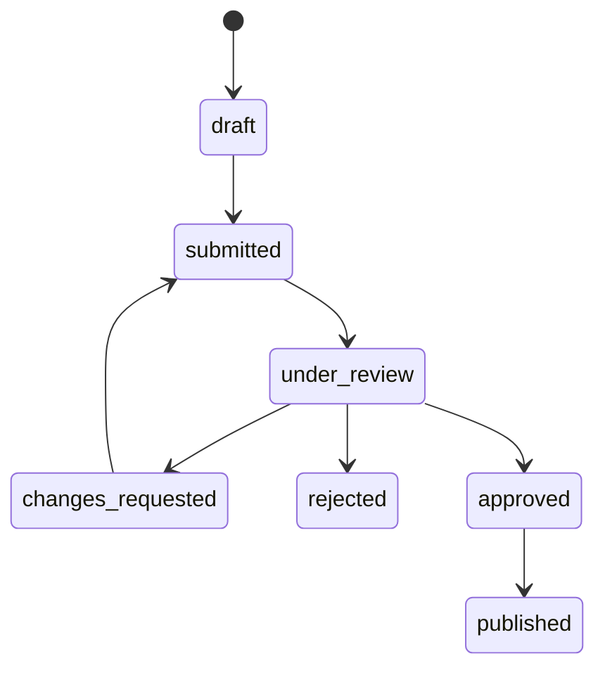

# Phase 10 — Published updates and license activation

Fortify, RBAC, author onboarding, catalog, storefront, checkout, immutable purchases and private downloads remain in the existing Laravel/Vue/Inertia application. No dependencies were added. This phase adds proposed updates to published software and installation activation; it grants no upgrade entitlements.

## Live and proposed versions

`Product` remains the live business-facing projection. `ProductRevision` stores a separate proposed document containing the editable business fields, category and tag IDs, feature rows and commercial offer configurations. It references the existing ProductRelease through `base_release_id` and unique `proposed_release_id`. This avoids a duplicate Product application/table tree: the proposal is an aggregate document, while publication materializes the existing normalized Product relationships/features/offers. Files stay in existing media/artifact tables and filesystem storage, never in JSON.

A revision has product, base/proposed release, creator, status, content and timestamps. Its release identities and creator are immutable. PostgreSQL permits one open revision per product with a partial unique index excluding rejected/published revisions. Rejected proposals remain historical; a different unique version can begin a new proposal. Old rejected release version numbers are not reused.



Revision statuses use the existing ProductStatus enum; Product.status stays published throughout this workflow. Release statuses continue using Phase 5: draft → in_review → draft/rejected/approved → published. Official ownerless products follow these same stages, with permission-authorized admin actors. There is no automatic approval or publication.

Managed versions retain the established stable MAJOR.MINOR.PATCH syntax, maximum 50 characters, no leading zeros, prerelease or build suffixes. `SemanticVersion` compares component lengths then digits, avoiding lexicographic mistakes and integer overflow. Versions must be unique within the product and strictly greater than its currently published release when creating/editing/submitting/approving/publishing a proposal.

## Proposed content and files

`RevisionContent` isolates editable name/slug/category, descriptions, business problem, audience/benefits, currency, demo and preview details, documentation URL, activity, SEO, industries, technologies, features and offers. Owners cannot propose ownership, origin, status, public identity or featured status. Nested feature/offer IDs are prohibited: a revision configures fresh rows. Backend ProductRequest validation is reused through RevisionRequest, including HTTP/HTTPS URLs, catalog IDs, decimal-string prices, controlled currencies/licenses, nested row validation and exactly one active default offer. Draft and submission validation remain separate.

`product_revision_media` references selected media for the proposal independently of `ProductMedia.is_current`. Creating an update initially selects current presentation media. New images are validated using Phase 5 and inserted with is_current=false. Replacing/removing a proposed cover/gallery selection does not change live media flags or bytes. New source ZIP/documentation artifacts belong to the new ProductRelease. Replacing an artifact retires its old metadata rather than overwriting it. Historical rows and objects remain retained. FileRetention recognizes revision media references, in addition to immutable submissions and entitlements.

Uploads reuse ProductFiles' staged cleanup/compensation and Laravel Filesystem architecture. Private storage validation, archive structural limits, MIME/extension checks, image dimensions and generated storage filenames remain authoritative. FileChecksum streams stored objects when verifying SHA-256; it does not load commercial ZIPs into PHP strings. A new source package is required for the proposed version; the old release's package is not silently copied.

## Submission, moderation and publication

New update rounds reuse ProductSubmission, ProductReviewFeedback, ProductLifecycleEvent and immutable file-reference tables. Nullable product_revision_id distinguishes update rounds/events from original product moderation. Round numbers continue increasing per product. Original ProductWorkflow and review queue explicitly select original rounds, so a proposed update does not replace their workflow context.

Snapshot version 3 freezes proposed business content, catalog identities, features, offer terms including activation limits, media identity/metadata/SHA-256 and release/version/changelog/notes/artifact IDs/SHA-256. Every resubmission creates a new immutable round. Frozen media URLs resolve through retained file rows; private storage locators never enter editor/review snapshots.

Readiness reuses Phase 4 business rules without reloading live relationships: active category and product, meaningful descriptions/problem, audiences/benefits, features, active industries/technologies, active offers/exactly one active default, controlled money/currency/license terms and live demo. It additionally requires one stored cover, at least two stored screenshots, release changelog and exactly one current private source ZIP. Optional documentation remains optional. Approval/publication verify current file checksums and exact artifact metadata against the frozen round; missing or changed bytes block the action.

`ProductUpdates` centralizes transitions. Writers lock Product → revision, and publication also locks the current release; transitions lock the latest review round and involved release. State, ownership, permissions and claim are checked after locking. Duplicate submit/start/publish requests fail with a useful conflict/validation message. Three transaction attempts cover deadlock retries.

Authors with existing product ownership and permissions can create/save/submit their own updates. Reviewers receive no edit/upload ownership. Review requires existing Phase 4 capabilities, forbids product-owner self-review (including multi-role admins), and decisions require the reviewer who claimed that round. Request Changes requires actionable structured feedback; rejection requires a summary. Approval alone leaves the storefront unchanged. Publishing requires the existing admin role plus products.publish permission.

Publication requires an approved latest round, checks readiness/checksums/version again and verifies that base_release_id still identifies the live release. In one transaction it promotes content/catalog/features, retires existing offers without deleting their purchased identities, creates new configured offers, changes current presentation flags, publishes the proposed release and records an immutable revision event. Featured state is preserved. Failure rolls back the whole promotion.

There is no new current-release flag or competing release model. The existing deterministic latest-published ordering (released_at then ID) identifies the current public release. Historical releases remain published and immutable; one-open-revision protection and Product locks serialize promotion. Old source packages, referenced media, submitted snapshots and review events are never replaced or deleted.

## Old and new customers

OrderItems continue using immutable price, package, terms and exact release snapshots. Existing entitlements/licenses/activations retain their original order item, release and exact source artifact. Old customers see/download their original version even after a new public version or price is published. New checkout uses the newly promoted active offer and current published release. Existing carts detect changed release/package terms and require confirmation.

`updates_period_days` remains a recorded commercial term. It does not grant access to newer files. Activation authorizes installation use of purchased software, not downloads, upgrades or ownership of the current storefront version. Neither publication nor activation rewrites existing entitlement identity.

## Routes and Vue workspace

All update workspaces use the existing authenticated app, policies, Inertia forms/toasts and Wayfinder:

| Method    | Route                                                         | Purpose                                                   |
| --------- | ------------------------------------------------------------- | --------------------------------------------------------- |
| POST      | /workspace/products/{product}/updates                         | Create draft update with version                          |
| GET / PUT | /workspace/products/{product}/updates/{revision}              | Inspect / save proposed content                           |
| PATCH     | …/{revision}/release                                          | Save proposed version/changelog/notes                     |
| POST      | …/{revision}/files                                            | Upload proposed cover/screenshot/source ZIP/documentation |
| DELETE    | …/{revision}/media/{media}                                    | Remove a proposed media selection                         |
| POST      | …/{revision}/submit, start, changes, reject, approve, publish | Explicit transitions                                      |
| GET       | /admin/product-updates                                        | Paginated review queue, search/status filters             |

Route names are products.updates.* and admin.product-updates.index. Child resources must belong to the route-bound product. Actor/claim/status fields come from authenticated server context.

Published product details show Create New Version and recent update links. `products/Update.vue` distinguishes live and proposed versions, embeds the existing product editor for editable proposal content, manages the proposed release/files and shows prominent feedback/history and valid workflow controls. Frozen review uses the existing business-first ProductSummary. `products/Updates.vue` and sidebar navigation expose the permission-protected update queue. Existing author/admin applications and sidebars remain shared.

## Activation identity and commercial policy

Product gains an immutable unique public_uuid, populated for existing products in a forward migration and generated for new products. Client identity uses this UUID rather than mutable slug/name. Owners see it in their library.

ProductOffer gains activation_limit, controlled integer 1–1000, default 1. Product editing and revision offer configuration expose it explicitly. Checkout stores it on immutable OrderItem and includes it in cart term-change detection. License policy reads that purchased snapshot through the exact entitlement/item chain, never today's offer or license-type name. Legacy purchases receive the documented conservative snapshot default **one active installation**; single_business/multi_business/extended names are not used to invent limits. Changing an offer does not change a purchased limit.

`license_activations` contains a unique public UUID, restrictive license/entitlement/product references, installation HMAC, optional label/domain HMAC/display, active/deactivated status, activated/last_validated/deactivated times and timestamps. Unique (license_id, installation_id_hash) enforces one historical row per installation. An index supports license/status counts.

Clients generate and persist a stable installation UUID; no MAC/disk/CPU or hardware fingerprint is collected. Installation UUIDs normalize to lowercase and are stored only as keyed SHA-256 HMACs. Optional hostnames normalize case, trailing dot and URL scheme/path/port away; HTTPS://Example.COM/path becomes example.com. IDNs convert to ASCII when PHP intl supports it; unsupported invalid hostnames fail validation. Domain display plus HMAC is retained, with no DNS ownership verification. An existing installation's domain binding is immutable and must be supplied consistently.

`config/license_activation.php` accepts LICENSE_ACTIVATION_IDENTITY_KEY, falling back to APP_KEY. Configure a stable high-entropy secret of at least 32 characters in production secret management. Do not rotate it without a planned identifier migration/key-version strategy; changing it loses lookup compatibility with existing installation/domain HMACs. Existing encrypted license secrets still require their Laravel encryption key history. No raw installation UUID or plaintext license key is logged or stored in activation rows.

## Stateless JSON API contract

POST JSON only, without Fortify/browser session authentication or CSRF:

- /api/v1/licenses/activate
- /api/v1/licenses/validate
- /api/v1/licenses/deactivate

Request fields: license_key, product (immutable UUID), installation_id (UUID), optional installation_label (100 characters), optional domain. License keys accept the existing TMP-format hex groups with normalized case/separators. Query parameters are rejected, GET is not supported, and keys are not accepted as route identifiers. Use HTTPS; production HTTP requests return 426 HTTPS_REQUIRED. Configure TLS and trusted reverse proxies correctly; application validation cannot remove secrets a caller mistakenly puts into upstream access-log URLs.

The API hashes the normalized key using existing LicenseKeys, resolves the indexed fingerprint, and constant-time checks the candidate. It never queries encrypted plaintext or needs to decrypt the secret. It verifies active/unrevoked/unexpired license, active entitlement, exact product, immutable purchased item/release/artifact relationship and completed paid order with matching verified settlement. Storefront activity/publication/current release are not authorization inputs.

Successful activation/validation returns HTTP 200:

```json
{
    "valid": true,
    "code": "VALID",
    "activation_id": "public installation UUID",
    "license": {
        "status": "active",
        "product": "immutable product UUID",
        "purchased_version": "1.0.0"
    }
}
```

Deactivation returns the same safe identity with code DEACTIVATED. Failures return valid=false and a controlled code: INVALID_LICENSE (unknown well-formed key), PRODUCT_MISMATCH, LICENSE_INACTIVE, INSTALLATION_MISMATCH, ACTIVATION_NOT_FOUND or ACTIVATION_INACTIVE, HTTP 422. Activation capacity returns 409 ACTIVATION_LIMIT. Malformed/body/query/domain validation returns 422 INVALID_REQUEST with field errors. Standard unknown routes/methods retain JSON 404/405 handling. Responses contain no internal IDs, email/customer/order data, hashes, encrypted/plaintext key, private file locator or upgrade access.

Named Laravel rate limiting allows 60 requests/IP/minute overall and 20/IP/operation/minute, returning 429 RATE_LIMITED. Use a shared persistent cache in production (the existing configured cache architecture); test array cache is not a deployment rate-limit store. Failed attempts do not create audit spam or log attempted credentials. Successful validation updates last_validated_at without appending high-frequency history.

## Activation concurrency and audit

API writers follow User → Order → Entitlement → License → activation locking, consistent with existing purchase provisioning. The locked license serializes slot counting, duplicate requests, deactivation and reactivation. Same active installation is idempotent and retains its UUID without consuming another slot. Deactivated installations do not consume capacity. Reactivation reuses the same immutable identity, checks available capacity and appends a reactivated event. Domain/label binding is not silently changed. Unknown installations cannot deactivate other rows; repeated matching deactivation is idempotent.

`license_activation_events` retains activated/reactivated/deactivated action, activation reference, nullable authenticated owner actor and timestamp. API actors are null; owner browser actors come from auth. State transition events are immutable; prior deactivation times remain in history even when the current row is reactivated. No event is written for every validation or rejected key.

Owner library detail shows purchased limit, exact product identity, total active count and a paginated list of 20 installations with label/domain/status/times. Owners can deactivate through POST /account/library/{entitlement}/activations/{activation}/deactivate, using purchase/activation UUIDs and normal session/CSRF authorization, without re-entering a key. Another owner is denied; a mismatched entitlement/activation pair returns 404. Admin entitlement listings remain read-only and show total active count plus a bounded recent five installations, never the secret. Owner license pages retain private/no-store and encrypted Inertia history; local Inertia devtools recording excludes owner library and license API paths.

## PostgreSQL protection and operational migrations

Forward migrations:

1. 2026_10_05_220000_create_license_activations.php — public identity, offer/item commercial limit, activations/events.
2. 2026_10_05_221000_create_product_revisions.php — proposals, selected media, round/event revision references, one-open index and frozen-state guards.
3. 2026_10_05_222000_strengthen_update_activation_integrity.php — purchased limits, paid activation chain, state/timestamp checks and deferred mandatory transition audits.
4. 2026_10_05_223000_protect_update_review_actor_references.php — immutable update claims, self-review prevention and audit actor/round consistency.

Foreign keys restrict deletion of commercial and review history. PostgreSQL independently rejects inconsistent activation ownership/product/entitlement, invalid limits/states/times, capacity overflow (license row lock), identity rewrites, frozen proposals/media, mismatched submission/release references, invalid revision transitions, missing transition audits, self-review and changed claims. Offer/item insertion checks purchased activation limits. Existing commerce snapshots and historical submissions remain immutable. Rollback deliberately refuses destructive removal of this history; use reviewed forward corrections.

Verification migrations and every test setup/worker assert both current_schema() and search_path against random disposable schemas before fixtures. No RefreshDatabase/truncate touches the application database. Test connections, private configs and credentials are removed, schemas dropped, and browser storage links cleaned. Normal local deployment applies only the validated forward migrations; no Phase 10 development fixtures/seeding are added to the application schema.

## Tests, verification and commands

PhaseTenTest adds HTTP/controller/service and PostgreSQL integrity cases for proposal isolation, SemVer boundaries/overflow, new package readiness, ownership/self-review, claim/decision/duplicate actions, corrections/new frozen rounds, rejection/new proposals, publication rollback/checksums, retained old ZIP and prices, new purchase version/limit, API contracts/limits/privacy/HTTPS, hidden-product access, owner IDOR and raw immutable writes.

```sh
php artisan migrate --no-interaction
php artisan route:list --except-vendor
php artisan event:list
php artisan test --compact
php tests/Support/verify-phase10-suite.php
php tests/Support/verify-phase10-concurrency.php
vendor/bin/pint --test
npm run check
npm run types:check
npm run build
vendor/bin/phpstan analyse
```

The isolated PostgreSQL suite includes PhaseTenTest plus all existing CommerceTest and EntitlementTest cases. The concurrency runner uses independent PHP workers and start barriers for installation capacity, duplicate installation, duplicate proposal, duplicate submission, competing review claims and duplicate publication. It asserts schemas/search paths before migration, seeding and workers; job/config files are private and cleanup runs in finally blocks.

External cached Playwright tooling (no manifest changes) verifies author creation/edit/new media/package, submission, reviewer changes, author resubmission, approval, admin publication, unchanged live storefront before publication, old customer's exact 1.0.0 ZIP, new checkout's exact 1.1.0 ZIP/new price, real HTTP activation/validation/deactivation/reactivation, owner deactivation, mobile and no JavaScript errors. Result details are recorded below after final checks.

## File inventory

Created:

- The four migrations above; ProductRevision and LicenseActivation models.
- ProductRevisionPolicy; Support/SemanticVersion.
- Services/Products/ProductUpdates, RevisionContent, Files/FileChecksum.
- Services/Entitlements/ActivationIdentity, LicenseActivationService; config/license_activation.php.
- Http/Requests/Products/RevisionRequest; Http/Controllers/ProductUpdateController and Api/LicenseActivationController.
- Events/Products/ProductUpdateTransitioned (after-commit event foundation, no notification delivery).
- routes/api.php and routes/product-updates.php.
- components/products/ProductUpdateLinks.vue; pages/products/Update.vue and Updates.vue.
- tests/Feature/PhaseTenTest.php; tests/Support/verify-phase10-suite.php and verify-phase10-concurrency.php.
- This document.

Modified:

- Models/Product, ProductOffer, ProductSubmission, Entitlement; Providers/AppServiceProvider; bootstrap/app.php; config/inertia.php.
- Http/Requests/Products/ProductRequest; Http/Controllers/Account/LibraryController.
- Services/Commerce/Checkout and CartService; Services/Entitlements/LibraryPresentation.
- Services/Products/ProductEditor; Workflow/SubmissionReadiness, ProductWorkflow, ProductReviewWorkspace; Files/ProductFiles and FileRetention.
- routes/web.php and library.php.
- components/AppSidebar.vue; pages/products/Form.vue; pages/library/Show.vue and Index.vue; types/product.ts and library.ts.
- Generated Wayfinder routes/actions and production build assets.

No actual .env, authentication implementation, role permission assignments, dependency manifests, historical migrations, order/entitlement identities or earlier tests were removed/replaced.

## Deferred decisions

Explicit upgrade grants/eligibility, refund/revocation orchestration, commissions/payouts, KYC, customer reviews/support and richer seller profiles remain later phases. The existing development gateway remains opt-in; production payments still need a real provider. Activation is an online authorization foundation, not tamper-proof DRM or DNS ownership proof. Richer assignment/reassignment, transactional event outbox/email delivery, malware scanning, image optimization, rejected-upload retention tooling and historical media archival remain deferred. Immutable rejected/closed proposals retain files intentionally; no implicit destructive garbage collection is introduced.

Stable installation HMAC key rotation needs a dedicated migration/key-version design. Future revocation must lock and transition entitlement/license state consistently; retained activation rows will fail validation through their existing access checks. License-type commercial semantics do not implicitly override the purchased activation limit.

Known pre-existing issues: empty UserFactory::withTwoFactor() return reported by PHPStan, optional fontaine build warning, and no Git repository for a baseline diff. Only the known factory error is allowed to remain in static analysis.

Phase 10 ends here; Phase 11 is not implemented.

## Completion results

- **63 new Phase 10 cases:** 49 pass on SQLite and 14 production PostgreSQL integrity cases skip there; all execute in the PostgreSQL runner.
- **Full Laravel regression:** 529 passed, 51 skipped, 3,394 assertions (580 cases). Earlier tests remain present.
- **Isolated PostgreSQL:** 218 passed, 1 skipped, 1,085 assertions (219 cases), covering Phase 10 plus the complete existing commerce and entitlement suites. The legacy missing-license deletion simulation remains intentionally incompatible with PostgreSQL's commercial-history guard.
- **Independent PostgreSQL concurrency:** six scenarios passed, 21 assertions; current/historical release retention and activation capacity/idempotency verified.
- **Real browser/HTTP verification:** complete proposed update → corrections → resubmission → approval → publication, old/new exact version ZIPs and price, all activation operations and owner deactivation passed. Mobile owner library and JavaScript checks passed. Browser requests used a private router that checked both schema and search path before processing writes. Temporary schema, storage symlink, server and credentials were removed.
- **Pint, frontend formatting/lint, Vue TypeScript and production build:** passed. PHPStan reports only the pre-existing empty UserFactory::withTwoFactor() return. The existing optional fontaine warning remains.
- **Local forward migrations:** all four applied successfully. Application orders/entitlements remained zero, the existing one Product remained, and no revision/activation fixtures were inserted. No integrity triggers were disabled. All Phase 10 verification schemas were removed.
- Route/event inspection, migration preview/application, Wayfinder generation, formatter commands, full suite, isolated PostgreSQL suite, worker concurrency, external browser/JSON HTTP checks, PHPStan and production build were executed. No development product/activation seeder was added.

Stop after Phase 10. Explicit upgrade entitlement, commissions and payouts remain deferred.
