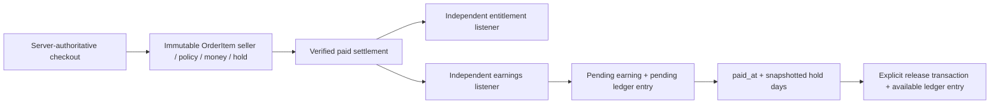

# Phase 11 — Marketplace commission and author earnings

Phase 11 adds purchase-time commission terms, immutable author earnings and an append-only ledger. Fortify, RBAC, product moderation, release updates, checkout/payment verification, entitlements, exact purchased downloads and license activation retain their existing contracts. No payout, bank-account collection, refund processing or new payment provider is implemented.

## Financial boundary



A cart, pending order, failed payment or unverified callback creates no earning. The authoritative commercial timestamp is `Order.placed_at`, set by the server during checkout. Every item snapshots its seller and financial terms before payment. Payment delays, later policy deactivation, ownership transfers, offer changes and new releases never recalculate those terms.

## Commission policies

`commission_policies` stores `id`, name, percentage `NUMERIC(5,2)`, hold days, active/default flags, effective start/end timestamps, nullable creator and timestamps. Initial explicit development seed: **20.00% and seven days**. The seeder does nothing if any policy already exists; it never restores/deactivates/replaces an administrator's policies. `DatabaseSeeder` calls it only in local/testing environments. Production must deliberately configure an approved policy through the management page or an explicit deployment seed.

Selection uses the single active default whose interval contains the server checkout timestamp: start inclusive, end exclusive. PostgreSQL GiST exclusion prevents overlapping active default intervals without requiring an extension. An absent effective policy fails author checkout atomically with a useful cart error; official-product checkout does not require an external-author commission policy. No product/author-specific override is introduced.

The management page schedules a new effective version and closes the preceding interval at the new start. A later already-scheduled policy must be deactivated before inserting a replacement ahead of it. Financial fields of a used policy are immutable, including name, percentage, hold days, start and creator. Closing an interval cannot contradict a recorded checkout. Operational deactivation is permitted and preserves past purchases; it may intentionally pause author checkout. Reactivation/editing financial history is not offered. Create a replacement policy to change terms.

Policy writers and checkout selection share a transaction-scoped PostgreSQL advisory lock, followed by policy row locks. Half-written policy changes cannot become commercial snapshots. The selected percentage is database configuration, never a constant in the commission calculation service.

## Checkout snapshots and historical orders

New `order_items` fields:

| Field                                  | Meaning                                                                  |
| -------------------------------------- | ------------------------------------------------------------------------ |
| seller_type                            | `author` or `platform`                                                   |
| author_user_id / author_profile_id     | Purchase-time seller identity; profile may be absent for a legacy author |
| commission_policy_id / commission_rate | Selected policy and exact percentage                                     |
| commissionable_amount                  | Exact item line total                                                    |
| commission_amount / author_amount      | Rounded marketplace commission and exact seller remainder                |
| earning_hold_days                      | Purchase-time settlement window                                          |

Existing item currency, purchased release, version, offer identity/name/description and seller name remain authoritative. Actor/seller/policy/money values are derived server-side; no earning-creation or earning-edit HTTP endpoint exists.

The actual application PostgreSQL database was inspected before implementation: **zero orders, zero paid orders and zero order items**. No financial backfill was needed. Migration fields are nullable for existing legacy rows, which remain explicitly unknown and are excluded from automatic earnings recovery. PostgreSQL rejects _new_ items without a seller snapshot. If another deployment has historical orders, operators must use a reviewed deterministic migration with evidence of original terms; current ownership/policies must never be guessed into them.

Official items use `seller_type=platform`, retain their line total as platform seller proceeds and have no external-author commission/net/hold references. They generate no fake AuthorEarning and are not called a 100% commission. The earnings report explicitly covers author sales represented by the ledger; broader platform-revenue accounting is deferred.

## AuthorEarning and ledger schema

`author_earnings` has a unique public UUID, restrictive author/profile/order/item/product/release/policy references, currency, gross, rate, commission, author net, hold days, status, availability/release timestamps and ordinary timestamps. `order_item_id` is unique: one original earning per eligible purchased item. Money is `NUMERIC(14,2)`; currencies remain INR/USD/EUR/GBP. Foreign keys retain financial history rather than cascade-delete it.

The model relates to author, profile, order, item, product, release, policy and ledger. OrderItem has one earning. Models guard all mass-assignment fields. Money, references and identity cannot be changed or deleted. The only current state transition is `pending → available`, with an append-only availability record. Held/reversed states require a future deliberate migration and domain workflow.

`author_earning_ledger_entries` has an ID, restrictive earning/author references, currency, type, exact amount and `occurred_at`. It uses this occurrence timestamp rather than mutable model timestamps. Current types:

- `earning_pending`: author net first recorded after paid settlement.
- `earning_available`: that same amount becomes available after the hold.

The second entry moves money between balance buckets; it is **not another sale**. Unique `(author_earning_id,type)` prevents duplicate movement. Entries cannot be updated or deleted. PostgreSQL guards matching earning/author/currency/net and occurrence times. Deferred constraints require a pending entry with every earning and an availability entry with every released earning; both are written in the same transaction. New earnings must initially be pending, even for zero-day holds.

Future refunds, disputes, reservations and payouts must add compensating ledger types and revise aggregation deliberately. Original economic facts and original entries must remain untouched. An available balance is potentially eligible for future payout processing, not proof that money has been transferred.

## Exact money and currencies

`CommissionMath` reuses Phase 7 `Money` and Brick Math. Inputs are exact decimal strings. Rates are bounded 0–100, with up to two decimal places. Commission = gross × rate ÷ 100, rounded to two currency decimals using **HalfUp**. Net = exact gross minus rounded commission. Thus gross always equals commission plus net. Zero-price, 0% and 100% sales remain valid and auditable. Fractional-cent inputs and invalid rates fail.

Phase 7 has quantity one, line total equal to unit price, zero discount and zero tax; commission therefore applies to the actual immutable item line total. No tax accounting or invented order-discount allocation is introduced.

Balances are grouped SQL aggregates by currency. Lifetime net earned is the sum of pending-entry amounts; available is the sum of availability-entry amounts; pending is their exact difference. Admin gross/commission/net/buckets are computed in a **single grouped SQL statement**, avoiding inconsistent cross-query snapshots during concurrent paid sales. Official proceeds are outside this author-earnings report. Vue reuses the existing BigInt/decimal-string price formatter. No floats or currency conversion are used in financial calculations.

## Paid provisioning, recovery and availability

`ProvisionAuthorEarnings` independently listens for the existing after-commit `OrderPaid` event. `EarningProvisioner` locks the buyer and order in the existing commerce order and checks completed/paid status plus the exact settled payment amount/currency/order identity. It processes author items in ID order from immutable snapshots only. Earning and initial ledger entry commit together. Multi-author orders produce independent amounts for each item; official items are skipped.

A listener failure is logged using only order ID and exception class. Verified payment truth stays paid. Entitlement provisioning remains a separate listener; neither downstream service becomes a payment precondition.

```bash
php artisan commerce:reconcile-author-earnings
php artisan commerce:reconcile-author-earnings --order=TMP-... --dry-run
php artisan commerce:release-author-earnings
```

Recovery scans paid author items missing an earning in chunks of 100, supports an order restriction and dry run, and reports counts/errors. It never infers missing historical seller/rate data. Provisioning serializes on the order and unique item constraint, so listeners, duplicate callbacks and reconciliation cannot duplicate earnings.

Availability is snapshotted as `paid_at + earning_hold_days`. Release scans due pending earnings in chunks of 100, row-locks and rechecks each earning, changes status and appends the availability entry atomically. No early/future-dated release is accepted by PostgreSQL. Repeated workers are harmless. Zero-day earnings still await explicit release processing. Both commands run every ten minutes with `withoutOverlapping`; row locks and uniqueness remain the authoritative protection across concurrent invocations.

After-commit domain events `AuthorEarningRecorded` and `AuthorEarningAvailable` carry only the earning ID. No mail, push, persisted notification delivery or outbox is added; future notification delivery requires its own retry/delivery guarantees.

## Authorization, privacy and routes

| Route                                       | Authorization / behavior                                                               |
| ------------------------------------------- | -------------------------------------------------------------------------------------- |
| GET /author/earnings                        | Authenticated author role; approved/legacy author conventions preserved; own rows only |
| GET /author/earnings/{public_uuid}          | Same role plus immutable seller ownership; another author's UUID returns 404           |
| GET /admin/earnings                         | `commissions.view`, read-only report                                                   |
| GET /admin/earnings/{public_uuid}           | `commissions.view`, read-only commercial/ledger detail                                 |
| GET /admin/commissions                      | `commissions.view`                                                                     |
| POST /admin/commissions                     | `commissions.view` + `commissions.manage`; service also authorizes manage              |
| POST /admin/commissions/{policy}/deactivate | Same management permissions                                                            |

No permissions or role assignments are changed. Customers and reviewers do not gain author-finance access. A user explicitly granted commission permissions may use the relevant administrative views. Financial pages use encrypted Inertia history, private/no-store HTTP responses and devtools exclusions.

`EarningPresentation` explicitly allow-lists UUID, safe order reference, purchased product/offer/version, currency, gross/rate/commission/net, state and dates. Admins additionally see the author's display name. Customer email/address, payment provider data/secrets, license keys, private artifact paths, moderation internals and arbitrary model internals are absent. Protected seller/profile/policy/creator FKs and profile-deletion validation retain account history. There is no balance editing, withdrawal button, payout method or bank/UPI collection.

## Vue workspace

- `earnings/Index`: real currency-separated totals, search/status/currency filters, paginated safe item history, purchase date/version, exact gross/commission/net and detail links.
- `earnings/Show`: immutable purchased economics, hold dates and ledger activity.
- `earnings/Commissions`: policy history, future-version form, validation feedback, processing state and confirmed deactivation.
- `components/earnings/Balances`: reusable author/admin balance buckets and honest payout availability wording.
- Author dashboard includes actual ledger balances and a My Earnings link.
- Existing AppSidebar uses role/permission helpers for My Earnings, Author Earnings and Commission Policies; no parallel application or state manager.
- Existing layouts, toast conventions, Wayfinder-generated routes and TypeScript are reused. No dependency was installed.

Listings paginate 15 rows, preserve query parameters and eager-load necessary item/order/author relationships. Balance computation never loads all earnings into PHP. Indexes cover author/status/currency/date, pending availability, unique purchased items, ledger identity/type and policy intervals.

## Cart correction discovered during Phase 11

The multi-author test exposed a pre-existing cart eager-loading issue: applying a release limit to the underlying query selected one release for the entire cart. `CartService` now applies the limit to the HasMany relationship, selecting one release **per product**. This is necessary for valid mixed-author/official multi-item checkout and preserves exact purchased-release selection. No unrelated authentication/product rewrite was made.

## Files created

- `app/Enums/AuthorEarningStatus.php`
- `app/Models/{CommissionPolicy,AuthorEarning,AuthorEarningLedgerEntry}.php`
- `app/Services/Earnings/{CommissionMath,CommissionPolicies,EarningProvisioner,ReleaseEarnings,ReconcileEarnings,EarningPresentation}.php`
- `app/Listeners/ProvisionAuthorEarnings.php`
- `app/Events/Commerce/{AuthorEarningRecorded,AuthorEarningAvailable}.php`
- `app/Http/Controllers/Earnings/{CommissionController,EarningController}.php`
- `database/migrations/2026_10_05_230000_create_author_earnings.php`
- `database/seeders/CommissionPolicySeeder.php`
- `routes/earnings.php`
- `resources/js/types/earnings.ts`
- `resources/js/components/earnings/Balances.vue`
- `resources/js/pages/earnings/{Index,Show,Commissions}.vue`
- `tests/Feature/PhaseElevenTest.php`
- `tests/Support/{EarningFixtures,verify-phase11-suite,verify-phase11-concurrency}.php`
- `docs/phase-11-author-earnings-commission.md`

## Files modified

- `app/Services/Commerce/{Checkout,CartService}.php`
- `app/Models/OrderItem.php`
- `app/Http/Requests/Settings/ProfileDeleteRequest.php`
- `app/Http/Controllers/Author/AuthorOnboardingController.php`
- `database/seeders/DatabaseSeeder.php`
- `routes/{web,console}.php`
- `config/inertia.php`
- `resources/js/components/AppSidebar.vue`
- `resources/js/pages/authors/Dashboard.vue`

Wayfinder action/route modules and production build outputs were regenerated. `.env`, dependency manifests, authentication and existing role seed assignments were preserved. The financial migration deliberately refuses destructive rollback; financial schema changes require reviewed forward migrations.

## Verification and operation

```bash
php artisan migrate --force
php artisan db:seed --class=CommissionPolicySeeder --force
php artisan wayfinder:generate --with-form
php artisan route:list
php artisan event:list
php artisan schedule:list
php artisan test --compact
php tests/Support/verify-phase11-suite.php
php tests/Support/verify-phase11-suite.php --earnings-only
php tests/Support/verify-phase11-concurrency.php
vendor/bin/pint --test
npm run check
npm run types:check
npm run build
vendor/bin/phpstan analyse --no-progress
```

The first two commands are normal deployment/local setup, **not verification fixture creation**. Do not refresh/truncate the configured application database. Automated PostgreSQL runners create random disposable schemas, set an exclusive search path, assert **both current_schema() and SHOW search_path before migrations/fixtures/worker writes**, and clean only their own schema/configuration files. Connection files are private; copied isolated tests use per-test transactions without RefreshDatabase. Recovery, commerce, entitlement and Phase 10 regressions execute against PostgreSQL. Browser verification likewise uses a guarded disposable schema, private credentials/configuration and isolated media/artifact storage, leaving no financial fixture in the application schema.

`PhaseElevenTest` has 73 cases covering decimal math/rounding/boundaries, seed idempotence, purchase snapshots, verified settlement, official/free/0%/100% sales, multi-author orders, delayed payment and future rates/holds, recovery/failure isolation, ownership/privacy, permission boundaries, account retention, ledger/balance movement, filters, dashboard integration and PostgreSQL immutability/arithmetic/identity/overlap/deferred-entry constraints. Nineteen cases require PostgreSQL and are intentionally skipped in the SQLite run.

Verification results are recorded below after final checks.

## Results and completion report

- Full Laravel regression: **583 passed, 70 skipped; 3,609 assertions across 653 cases**.
- Isolated PostgreSQL earnings + Phase 10 + commerce + entitlement regression: **291 passed, one existing skip; 1,319 assertions across 292 cases**.
- Final isolated PostgreSQL earnings-only check: **73 passed; 234 assertions; no skips**.
- Concurrent PostgreSQL workers: **five scenarios, 24 assertions passed**. Scenarios: duplicate verified callbacks, duplicate reconciliation, listener/recovery race, competing availability releases and policy switch during checkout.
- Browser: customer author-product checkout/payment, pending earning with exact purchased version/gross/commission/net, ledger detail, controlled hold release, separate INR/USD buckets, official sale excluded from author earnings, filters, admin gross/commission reports, mobile layout and no JavaScript errors passed. Temporary schemas/configuration/credentials/media were removed.
- Pint, frontend lint, TypeScript and production build: **passed**.
- PHPStan: only the pre-existing empty `UserFactory::withTwoFactor()` missing-return error; no Phase 11 errors. Optional fontaine warning remains pre-existing.
- Local forward migration and default policy seed: **one migration applied, one default policy seeded; application schema `public` still has zero orders/items/earnings/ledger entries**. No financial backfill or application-schema test purchase was performed.

The sections above provide the complete Phase 11 report: created/modified files and migration; policy selection/versioning; checkout seller/economic snapshots; earning/ledger schema; money/currency/official handling; provisioning/idempotency/recovery; hold/release schedule; author/dashboard/admin UI; privacy and PostgreSQL integrity; concurrency/events; automated/PostgreSQL/browser/full-suite results and commands; known issues and deferred work.

Future work deliberately remains separate: author/product rate overrides, tax/discount allocation if commercial rules expand, broader platform revenue accounting, held/reversed compensation workflows, refunds/chargebacks, payout reservations/transfers, payment-provider integrations and notification delivery. No payout bank data or payout action exists in this phase. Phase 11 stops here.
