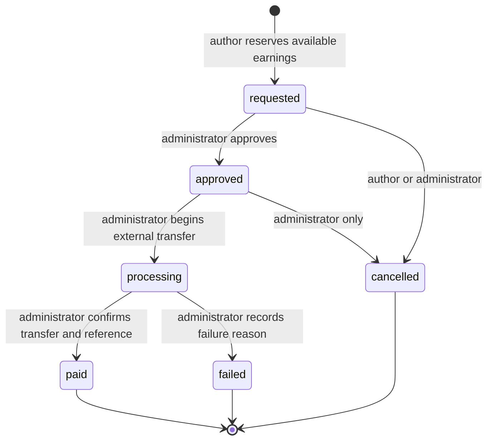

# Phase 12 — Author payouts

Phase 12 adds manual bank-transfer payout requests over Phase 11's immutable earning ledger. Fortify, RBAC, catalog, products, review/release workflows, checkout/payment settlement, entitlements, downloads and license activation remain intact. There is no automated bank transfer, provider API, refund, KYC, tax or currency-conversion integration.

## Architecture and schemas

`2026_10_06_010000_create_author_payouts.php` creates four tables and extends the existing ledger. `2026_10_06_020000_require_complete_payout_audit_chain.php` strengthens the audit chain through a second forward migration after the initial migration had been applied locally. Together, they do not rewrite historical earning facts or original ledger entries. Financial history is retained with restrictive foreign keys. Both `down()` methods deliberately refuse destructive rollback; restoration requires a reviewed forward migration or database recovery plan.

| Table                   | Stored information                                                                                                                                                                                                                                                                                                                                                                              |
| ----------------------- | ----------------------------------------------------------------------------------------------------------------------------------------------------------------------------------------------------------------------------------------------------------------------------------------------------------------------------------------------------------------------------------------------- |
| `author_payout_methods` | Internal ID, unique public UUID, author and optional existing author profile, `bank_transfer` type, currency, country, display label/bank name, last-four mask, encrypted destination, keyed identity fingerprint, active/disabled state, default flag, disable time and timestamps.                                                                                                            |
| `payout_requests`       | Internal ID, public UUID, unique `TMP-PAY-{year}-{ULID}` reference, per-author UUID request key, author/profile/method references, exact amount/currency, status, method type, immutable encrypted destination and safe JSONB display snapshot, requested time, reviewed/processing/paid/failed/cancelled actor/time pairs, reasons, internal note, external transfer reference and timestamps. |
| `payout_allocations`    | Restrictive payout/earning references, positive exact amount and creation time. A payout can allocate part of multiple earnings. `(payout_request_id,author_earning_id)` is unique.                                                                                                                                                                                                             |
| `payout_events`         | Restrictive payout/actor references, previous/new status, optional reason and occurrence time. Append-only, one event per payout/status.                                                                                                                                                                                                                                                        |

Money is `NUMERIC(14,2)` and decimal strings throughout Laravel/Vue. Brick Math performs exact arithmetic; the existing frontend formatter uses decimal strings/BigInt. Currency support is INR, USD, EUR and GBP, with separate balances and no FX conversion.

`AuthorPayoutMethod`, `PayoutRequest`, `PayoutAllocation` and `PayoutEvent` guard mass assignment. Requests, allocations and audit events retain immutable economic/history fields. Route model binding uses public UUIDs for methods and requests. Author profile references are nullable to support existing legacy authors without creating fake profiles.

### Ledger extension

The existing earning ledger gains a nullable `payout_allocation_id` reference and three movement types:

| Type                | Meaning                                                                  |
| ------------------- | ------------------------------------------------------------------------ |
| `earning_pending`   | Original net income recorded after verified payment.                     |
| `earning_available` | Original net income released after its hold.                             |
| `payout_reserved`   | Move available money into a payout reservation.                          |
| `payout_paid`       | Settle that reservation after administrator-confirmed external transfer. |
| `payout_released`   | Restore a failed or cancelled reservation to available.                  |

Original `(earning,type)` uniqueness is retained through a partial unique index where allocation is null. New `(allocation,type)` uniqueness prevents duplicate reservations/settlements/releases. Original `AuthorEarning.status` remains pending/available; it is not changed to a payout status.

`FinancialBalances` is the single grouped SQL source used by earning pages, dashboard summaries and payouts. In one statement per balance read, grouped by currency:

```text
P = sum(earning_pending)
A = sum(earning_available)
R = sum(payout_reserved)
L = sum(payout_released)
D = sum(payout_paid)

lifetime earned = P
pending         = P - A
available       = A - R + L
reserved        = R - L - D
paid out        = D
```

Gross/commission report totals count only original pending-income entries, so payout movements never create fictitious income. The existing earning detail now labels all five movement types.

## Destination security

Only manual `bank_transfer` methods are supported. The method form accepts account holder, bank, account number or IBAN, country, currency, routing/IFSC and SWIFT/BIC. India requires an account number plus the expected IFSC format; other supported countries require an account number or IBAN plus a routing/bank code or SWIFT/BIC. Country codes use the project's existing controlled list. These are format checks, not account ownership or transfer-eligibility verification.

Sensitive fields use Laravel `encrypted:array` casts in text columns. No full account number, IBAN, routing/SWIFT code, account holder, ciphertext or identity fingerprint is included in normal author/admin page props. Destination identity uses domain-separated HMAC-SHA256 with a server key, scoped to the author. It is not an enumerable unkeyed account hash. Currency and method identity cannot be edited; create another method for a different currency.

Normal responses contain only an explicit display allow-list: UUID, type, currency/country, label, bank name, account mask, state and default flag. Requests copy the encrypted destination into an independently encrypted immutable snapshot and retain a masked display snapshot. Later method changes/default changes/disabling cannot redirect an existing request. Editing requires full replacement instructions; forms do not prefill decrypted bank details. Saving a disabled method makes it active again. Disable keeps history and clears its default flag. Methods cannot be hard-deleted.

One active default per author/currency is enforced by a partial unique index and author locking. Identical normalized destinations cannot be duplicated for the same author, including disabled methods.

An administrator with both `payouts.view` and `payouts.manage` can explicitly POST to reveal a request's snapshotted transfer instructions only while approved or processing. The response is private/no-store JSON, separate from Inertia props. The UI keeps it only in component memory and clears it on hide/successful transition. It never navigates with instructions or puts them in URLs/history. This endpoint remains CSRF protected.

Payout pages use private/no-store responses and encrypted Inertia history. They are excluded from Inertia devtools. Bank input is excluded from Laravel old-input flashing. Query exceptions are logged using safe actor IDs/exception class, without SQL, bindings or bank details. No customer billing/payment/provider payload or private commercial artifact information is serialized. Admin-only notes and external transfer reference remain absent from author props. Admin review history displays actor names, never emails; author history omits administrator identity.

## Lifecycle and manual semantics



`PayoutWorkflow` owns all lifecycle writes. Approval and processing keep funds reserved and **do not send money**. Paid requires a nonblank external transfer reference and confirmation that the manual external transfer completed to the immutable destination. Failure and administrator cancellation require a useful reason. Author cancellation is allowed only while requested and gets a server-derived reason. Processing payouts cannot be cancelled; resolve them with paid/failed after checking the external transfer.

Paid, failed and cancelled are terminal. Invalid/stale/repeated actions return useful validation errors, with no extra ledger movement. A failed/cancelled request cannot be reopened; released funds may support a new request. Replaying the same idempotency key returns its original request, including a terminal one. Reusing a key with different amount/currency/method fails. A new UUID request key creates a distinct request.

Actor IDs, status, availability, author/profile IDs and allocations are never accepted from client financial input. Only currency, owned method UUID, exact amount and request UUID are used for request creation. Administrator reason/note/reference inputs cannot forge actor/time fields. No automated notifications, external messages or provider calls occur.

## Reservation, FIFO and concurrency

Request creation locks the author user row first, then the selected method and earning rows, inside a transaction with deadlock retries. The amount must be positive, meet the configured currency minimum and fit the authoritative available ledger balance. Pending, reserved, paid-out and other-currency funds cannot be allocated.

Eligible earnings are available, owned and currency-matching. Allocation uses deterministic `available_at ASC, id ASC` FIFO with bounded 100-row keyset batches. Remaining earning capacity is original net minus all reservations plus releases. Payouts may consume part of an earning or span earnings; paid allocations continue to consume capacity. Request, allocations, reservation entries and requested audit event commit atomically.

Transitions use the same author-first lock order followed by payout/allocation locks. Phase 11 availability release now also locks the author before the earning, so release/request races share the serialization boundary. A second requester waits and sees the first request's reservation. Competing terminal or cancel/approve actions re-read locked state and reject the losing transition.

Useful indexes include author/currency/state/time, payout state/currency/time, unique public references and idempotency keys, allocation earning/payout, partial active-default and ledger original/allocation uniqueness. Existing Phase 11 author/status/currency and availability indexes remain in use. Admin/author listings paginate 15 rows with deterministic ID ordering and preserved query strings. Author request forms load a bounded 100 active method choices. Allocation detail loads only relevant earning/item data; listing/report serialization does not fetch customer orders, review history or artifacts.

## PostgreSQL integrity

PostgreSQL is authoritative; SQLite tests cover application behavior but intentionally skip PostgreSQL triggers. The migration adds:

- Positive exact amounts, controlled currencies/types/statuses, destination presence and method state/default checks.
- Status/actor/time pairs, chronological transitions, no premature processing fields, terminal timestamps, mandatory paid reference and failure/cancellation reason.
- Immutable request author/currency/amount/destination/reference and retained methods/history; method/profile ownership validation.
- Allocation author/currency/available-state checks and per-earning capacity protection with author/earning row locks.
- Append-only allocations, events and ledger; matching allocation/earning/author/currency/amount and exact occurrence time for each ledger movement.
- Matching event previous/current state, actor and transition timestamp; the first event must be requested and every intermediate lifecycle step must be audited, including within a single transaction; immutable history and terminal states.
- Deferred transaction constraints requiring allocation totals equal request amount, mandatory current-state audit and matching reservation plus paid/release entries for every allocation. Checks read final transaction state, allowing several legitimate transitions in one transaction without accepting incomplete financial writes.
- Restrictive FKs for all authors, profiles, actors, methods, earnings and requests, including existing Phase 11 earning integrity.

Raw SQL cannot successfully commit an unsupported transition, allocation without reservation, paid state without settlement/audit, ownership/currency mismatch, over-allocation or mutation/deletion of retained financial records.

## Minimums and key configuration

```dotenv
PAYOUT_MINIMUM_INR=
PAYOUT_MINIMUM_USD=
PAYOUT_MINIMUM_EUR=
PAYOUT_MINIMUM_GBP=
PAYOUT_IDENTITY_KEY=
```

`.env.example` documents these settings; the actual `.env` was not modified. Blank minimums use explicitly labelled development samples **only** in local/testing: INR 1000.00, USD 20.00, EUR 20.00, GBP 20.00. Other environments require an explicit positive money-safe minimum per supported currency and fail closed for missing/invalid policy. The request form identifies unavailable policies instead of silently enabling requests. These samples are not production commercial policy.

The identity key defaults to the existing application key for development. Configure a separate stable secret of at least 32 characters in production. Preserve encryption keys and a stable identity key: application encryption-key rotation and HMAC-key rotation require a reviewed re-encryption/re-fingerprinting procedure, not blind environment changes. Backups must preserve decryption capability. This phase does not build a key-rotation subsystem.

## Routes and UI

All endpoints use existing authenticated web routes, Fortify sessions, CSRF, RBAC helpers, AppLayout/sidebar, Inertia toast conventions and generated Wayfinder definitions. No API payout endpoints were added.

| Routes                                                           | Authorization/function                                                                                    |
| ---------------------------------------------------------------- | --------------------------------------------------------------------------------------------------------- |
| `GET /author/payout-methods`, `/create`, `/{method}/edit`        | Author role; own methods only. Masked list and full replacement-input form.                               |
| `POST /author/payout-methods`                                    | Author creates own instructions/default.                                                                  |
| `PUT /author/payout-methods/{method}`                            | Author edits own instructions for future requests.                                                        |
| `POST /author/payout-methods/{method}/disable`                   | Author disables own method; retains history.                                                              |
| `GET /author/payouts`, `/create`, `/{payout}`                    | Author role; own history, separated balances, minimum policy and detail.                                  |
| `POST /author/payouts`                                           | Author atomically reserves own available earnings.                                                        |
| `POST /author/payouts/{payout}/cancel`                           | Own requested payout only.                                                                                |
| `GET /admin/payouts`, `/{payout}`                                | `payouts.view`; all-author queue, financial buckets, status/currency totals, allocations and actor audit. |
| `POST /admin/payouts/{payout}/{approve,process,pay,fail,cancel}` | `payouts.view` + `payouts.manage`; workflow/state validation independently enforced.                      |
| `POST /admin/payouts/{payout}/instructions`                      | Both permissions, approved/processing only; deliberate private/no-store reveal.                           |

The existing permissions/role seeder was not changed. Admins retain their existing payout capabilities; customers/reviewers/authors do not gain administrative payout rights. Multi-role authors remain supported. Cross-author resources return 404; customer/reviewer access is denied. Services independently enforce role/ownership/management authorization in addition to route middleware.

`payouts/Methods`, `MethodForm`, `Request`, `Index` and `Show` provide masked destination management, request validation, balance cards, filtered pagination, immutable snapshot/detail, allocation/audit history and permission/state-aware manual actions. They include empty states, disabled/loading submit actions, confirmation prompts, server validation errors and toast feedback. My Payouts/Payout Methods appear for authors; Payout Queue appears with `payouts.view`. Author dashboard and earnings pages link to payouts. Shared balance cards now show reserved and paid-out totals once per currency.

## Events and account retention

Six events implement Laravel's `ShouldDispatchAfterCommit`: `PayoutRequested`, `PayoutApproved`, `PayoutProcessing`, `PayoutPaid`, `PayoutFailed`, `PayoutCancelled`. Their only public payload is internal `payoutId`, allowing future listeners to reload authorized data. Rollback emits no event or financial movement. No listener performs email, external notification or transfer in this phase.

Self-service account deletion returns a clear validation error for retained payout methods or payout actor history, in addition to existing commercial/author/commission retention rules. Restrictive DB references provide the final boundary. Disabling a method never deletes instructions required by historical requests. A future legally reviewed anonymization/retention procedure is separate work.

## Tests and verification

`tests/Feature/PhaseTwelveTest.php` adds 78 cases covering methods/encryption/masking/defaults, ownership and role restrictions, format/payload validation, immutable destination edits, pending/minimum/unfunded amounts, exact partial/FIFO allocation, idempotency, private presentation, read/manage separation, actor derivation, all transitions, reasons/reference requirements, terminal behavior, reservation/release/payment accounting, separate currencies, production fail-closed policy, account retention, snapshot reveal, sensitive old-input exclusion, rollback/after-commit events, and PostgreSQL direct-write integrity.

`tests/Support/verify-phase12-suite.php` migrates a new randomly named PostgreSQL schema and runs Phase 12 + Phase 11 + Phase 10 + commerce + entitlement tests. `--payouts-only` runs only Phase 12. Both `current_schema()` and `SHOW search_path` must equal that exact schema before migration, fixtures and every test. Copied isolated tests use scoped transaction setup; application PostgreSQL never receives test fixtures or RefreshDatabase. Connection files are private and removed; schema cleanup is scoped to the generated name.

`tests/Support/verify-phase12-concurrency.php` uses separate PHP processes and readiness barriers in another disposable PostgreSQL schema. Parent and workers check both schema/path before writes. It verifies six scenarios and 31 assertions:

1. Two 4000 INR requests against 5000 available: exactly one reservation succeeds.
2. Two paid actions: one terminal settlement.
3. Failed versus paid: one terminal result with its corresponding exact movement.
4. Author cancellation versus admin approval: one valid outcome.
5. Availability release versus request: final balance includes the release and reservation exactly once.
6. Two partial allocators: no earning capacity is double-counted.

Browser verification uses the already available external Playwright/Chrome setup, without application manifest/dependency changes. It creates another disposable schema, private configuration, isolated sessions/storage and temporary accounts. Schema/path assertions run before migrations/fixtures and every HTTP request. It exercises method creation/masking, request, queue/approval/processing, explicit CSRF-protected reveal, external-reference payment, failed release, author cancellation, INR/USD isolation, safe normal props, mobile layouts and no JavaScript errors. No real bank transfer occurs. Disposable schemas, private configs, credentials and storage are removed afterward.

### Commands

```bash
php artisan migrate --no-interaction
php artisan route:list --except-vendor
php artisan event:list
php artisan schedule:list
php artisan test
php artisan test --filter=PhaseTwelveTest
php tests/Support/verify-phase12-suite.php
php tests/Support/verify-phase12-suite.php --payouts-only
php tests/Support/verify-phase12-concurrency.php
vendor/bin/pint
vendor/bin/pint --test
vendor/bin/phpstan analyse --no-progress
npm run check:fix
npm run check
npm run types:check
npm run build
```

Wayfinder actions/routes regenerate through the existing build integration. Browser setup/server/check/cleanup commands use external cache tooling and a private `APP_CONFIG_CACHE`, never altered application credentials.

Final verification on 6 October 2026:

| Check                              | Result                                                                                                                                                                                                                                         |
| ---------------------------------- | ---------------------------------------------------------------------------------------------------------------------------------------------------------------------------------------------------------------------------------------------- |
| Full Laravel regression            | **637 passed, 94 skipped; 731 cases, 3846 assertions.** No failures. The 94 skips are the existing 70 plus 24 Phase 12 PostgreSQL-only checks.                                                                                                 |
| Isolated PostgreSQL combined suite | **369 passed, 1 skipped; 370 cases, 1581 assertions.** Includes all 78 Phase 12 cases plus Phase 11, Phase 10, commerce and entitlements. The existing entitlement raw-deletion case remains intentionally skipped under PostgreSQL integrity. |
| PostgreSQL Phase 12 coverage       | **All 78 payout cases passed** within the combined PostgreSQL suite.                                                                                                                                                                           |
| PostgreSQL payout concurrency      | **6 scenarios passed, 31 assertions.**                                                                                                                                                                                                         |
| Browser                            | **Passed** author method/request, admin queue/approve/process/reveal/pay, failure/cancellation release, multi-currency summaries, private-prop checks, mobile and JavaScript checks.                                                           |
| Pint                               | Passed.                                                                                                                                                                                                                                        |
| Frontend lint/format               | Passed: 126 formatted files and 108 linted files, no warnings/errors.                                                                                                                                                                          |
| TypeScript                         | Passed.                                                                                                                                                                                                                                        |
| Production build                   | Passed; existing optional fontaine warning only.                                                                                                                                                                                               |
| PHPStan                            | Only the known pre-existing missing return in `UserFactory::withTwoFactor()` at line 49. No Phase 12 errors.                                                                                                                                   |
| Local migration                    | Applied successfully with `php artisan migrate --no-interaction`.                                                                                                                                                                              |
| Route/event/schedule inspection    | Passed. No new payout schedule or provider listeners.                                                                                                                                                                                          |
| Fixture isolation/cleanup          | Application `public` schema has zero orders/items/earnings/ledger entries/methods/requests/allocations/events, and the original single commission policy. All disposable Phase 12 schemas and browser credentials/config/storage were removed. |

No application test-bank records or synthetic paid orders were created. Tests alone do not verify actual bank ownership or external transfer settlement.

## Files created

- `database/migrations/2026_10_06_010000_create_author_payouts.php`
- `database/migrations/2026_10_06_020000_require_complete_payout_audit_chain.php`
- `config/payouts.php`
- `app/Enums/PayoutStatus.php`, `PayoutMethodType.php`
- `app/Models/AuthorPayoutMethod.php`, `PayoutRequest.php`, `PayoutAllocation.php`, `PayoutEvent.php`
- `app/Services/Payouts/PayoutMethods.php`, `PayoutMinimums.php`, `FinancialBalances.php`, `PayoutWorkflow.php`, `PayoutPresentation.php`
- `app/Events/Payouts/PayoutRequested.php`, `PayoutApproved.php`, `PayoutProcessing.php`, `PayoutPaid.php`, `PayoutFailed.php`, `PayoutCancelled.php`
- `app/Http/Controllers/Payouts/PayoutMethodController.php`, `PayoutController.php`
- `routes/payouts.php`
- `resources/js/types/payouts.ts`
- `resources/js/pages/payouts/Methods.vue`, `MethodForm.vue`, `Request.vue`, `Index.vue`, `Show.vue`
- `tests/Feature/PhaseTwelveTest.php`
- `tests/Support/PayoutFixtures.php`, `verify-phase12-suite.php`, `verify-phase12-concurrency.php`
- `docs/phase-12-author-payouts.md`
- Generated Wayfinder author payout/method and admin payout route/controller modules.

## Files modified

- `app/Services/Earnings/EarningPresentation.php`: centralized ledger balance/report delegation.
- `app/Services/Earnings/ReleaseEarnings.php`: author-first locking shared with reservations.
- `app/Http/Requests/Settings/ProfileDeleteRequest.php`: payout financial/destination retention.
- `bootstrap/app.php`: sensitive payout input not flashed.
- `config/inertia.php`: payout devtools exclusions.
- `.env.example`: explicit minimum/identity key settings; actual `.env` unchanged.
- `routes/web.php`: includes payout routes.
- `resources/js/components/AppSidebar.vue`: permission/role-aware payout navigation.
- `resources/js/components/earnings/Balances.vue`: reserved/paid buckets and manual semantics.
- `resources/js/pages/authors/Dashboard.vue`, `resources/js/pages/earnings/Index.vue`: payout links.
- `resources/js/pages/earnings/Show.vue`: all ledger movement labels.
- `resources/js/types/earnings.ts`: reserved/paid balance fields.
- Existing generated Wayfinder aggregate exports/build artifacts regenerate normally.

No packages were installed. No role/permission assignment, authentication flow, existing historical migration or actual `.env` was rewritten.

## Deferred work and decisions

Manual bank transfer was chosen as the smallest complete, truthful payout mechanism. Approval is internal authorization, processing denotes external work, and paid records an administrator's confirmation; the software does not attest independently to bank settlement. Operators must verify the external transaction before marking paid/failed to prevent releasing money already sent.

Future automated providers should consume safe after-commit events, add provider idempotency/reference/verified-webhook handling and preserve immutable destination snapshots, reservations and existing audit. KYC, beneficiary verification, sanctions/tax handling and jurisdiction-specific payout rules are deferred. PayPal/Payoneer are not advertised as operational methods. Future refunds/disputes need compensating ledger entries and deliberate interaction with already reserved/paid allocations; never rewrite original commission/earning or payout history. Financial key rotation, dedicated admin reveal-access audit, retention/anonymization and operational reconciliation remain separate work.

No refunds, automated payout provider, new customer payment flow, FX, or Phase 13 functionality was implemented.

## Completion report

| #   | Requested item          | Outcome                                                                                                                                                                                           |
| --- | ----------------------- | ------------------------------------------------------------------------------------------------------------------------------------------------------------------------------------------------- |
| 1   | Files created           | Two migrations, config, enums, four models, five services, six events, two controllers, routes, five Vue pages/types, fixtures/two verification runners/tests and this document; inventory above. |
| 2   | Files modified          | Shared earnings balance/release, account retention, exception/devtools configuration, route include, environment example, navigation/dashboard/earnings UI/types; inventory above.                |
| 3   | Migrations              | Two forward migrations, applied locally and repeatedly verified in disposable PostgreSQL schemas.                                                                                                 |
| 4   | Payout methods          | Author-owned UUID manual bank methods, active/disabled and currency-specific default.                                                                                                             |
| 5   | Encryption/masking      | Laravel encrypted arrays, stable keyed HMAC identity, last-four normal display, explicit protected reveal.                                                                                        |
| 6   | Request schema          | Immutable amount/currency/author/method/snapshots, unique reference/idempotency key, lifecycle actors/times/reasons/reference.                                                                    |
| 7   | Lifecycle               | Requested → approved → processing → paid/failed; requested/approved cancellation under distinct permissions; terminal outcomes.                                                                   |
| 8   | Reservation accounting  | Transactional reservation at request, exact settlement/release later.                                                                                                                             |
| 9   | Ledger extension        | Three allocation-linked payout movement types; original earning entries unchanged.                                                                                                                |
| 10  | Allocation/FIFO         | Available time then earning ID, bounded keyset batches, owner/currency/capacity protection.                                                                                                       |
| 11  | Partial allocation      | One earning may partially fund several requests; one payout may span earnings.                                                                                                                    |
| 12  | Balances                | One grouped ledger SQL source; original income, pending, available, reserved, paid buckets.                                                                                                       |
| 13  | Currencies              | INR/USD/EUR/GBP separately; no floats or currency conversion.                                                                                                                                     |
| 14  | Minimum                 | Development-labelled samples; explicit positive production per-currency policy, fail closed.                                                                                                      |
| 15  | Author UI               | Methods, full replacement editor, request, filtered own history/detail/cancel and summaries/navigation.                                                                                           |
| 16  | Admin UI                | Paginated filtered queue, currency/status totals, destination/allocations/audit and guarded actions.                                                                                              |
| 17  | Manual processing       | No transfer sent by software; operator explicitly executes external transfer.                                                                                                                     |
| 18  | Paid                    | Requires reference/manual confirmation; settles each reservation once, terminal audit.                                                                                                            |
| 19  | Failed/cancelled        | Reasons recorded and money returned exactly once; no reopening terminal request.                                                                                                                  |
| 20  | Audit                   | Append-only state/actor/time history, admin actor names, owner-safe feedback.                                                                                                                     |
| 21  | Authorization           | Existing roles/permissions, owner 404s, authoritative service checks, separate read/manage capabilities.                                                                                          |
| 22  | Privacy/security        | Allow-list props, encrypted history, no-store, devtools exclusions, no bank old-input/SQL logging, CSRF-protected reveal.                                                                         |
| 23  | PostgreSQL              | Checks, restrictive FKs, immutable/append-only guards, allocation capacity and deferred ledger/audit completeness.                                                                                |
| 24  | Concurrency             | Author-first locks, transactional re-read/retries, all six independent-worker races passed.                                                                                                       |
| 25  | Events                  | Six after-commit safe-ID events, rollback verified; notifications/provider listeners deferred.                                                                                                    |
| 26  | Retention               | Clear account-delete errors and DB restrictions; methods/history not hard-deleted.                                                                                                                |
| 27  | Tests                   | 78 Phase 12 cases plus unchanged existing tests.                                                                                                                                                  |
| 28  | PostgreSQL verification | 369 passed/1 existing skip combined; disposable schemas/path checks and cleanup.                                                                                                                  |
| 29  | Browser                 | All author/admin/manual states, privacy, currencies, responsive checks passed; no JS errors.                                                                                                      |
| 30  | Full regression         | 637 passed/94 expected skips; no failures.                                                                                                                                                        |
| 31  | Pint/lint/types/build   | All passed; optional fontaine warning pre-existing.                                                                                                                                               |
| 32  | PHPStan                 | Only existing UserFactory missing-return issue remains.                                                                                                                                           |
| 33  | Known issues            | Pre-existing factory/font warning; no source-control metadata available in this workspace.                                                                                                        |
| 34  | Deferred                | Automated providers, refunds, KYC, beneficiary verification, FX/tax, notifications and Phase 13.                                                                                                  |
| 35  | Decisions               | Manual bank transfer, immutable encrypted destinations, allocation-based ledger movements, author-level serialization and retained financial history.                                             |
