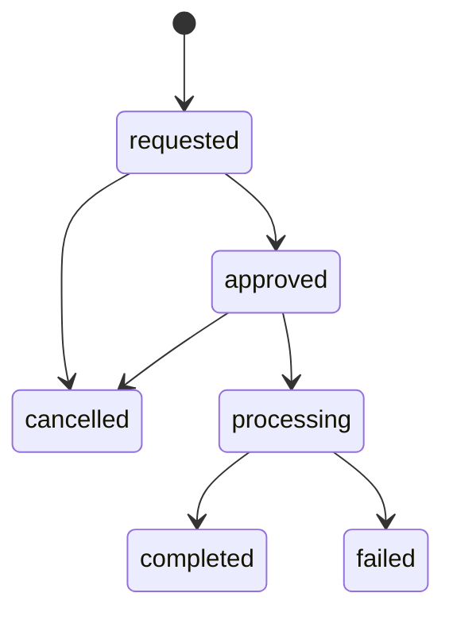

# Phase 13 — Refunds, compensating accounting and purchased-access revocation

Phase 13 adds whole purchased-item refunds with administrator-confirmed manual external settlement. It preserves the sale, payment, purchase snapshots, commission policy, original author earning, payout allocations, paid transfers, download records and installation history. No payment-provider refund API, customer wallet, tax adjustment, dispute handling, reviews, support or email notifications were added.

## Domain and lifecycle



The customer may cancel only a requested refund. Administrators with `refunds.manage` approve, start processing, complete, fail, or cancel requested/approved refunds. Failed, cancelled and completed attempts are terminal. A failed/cancelled attempt releases its item claim; a new eligible attempt gets a new reference and retains the original history.

`RefundWorkflow` is the only application write service. Controllers validate filters, render allow-listed projections and delegate actions. Every mutation derives customer, author, currency, amount, economics, actors and timestamps from authenticated users and immutable purchases. Request payloads cannot choose these values.

References are unique `TMP-REF-{year}-{ULID}` strings. Primary refund URLs bind the separate UUID; order routes retain the existing human-readable order reference. Customer ownership failures return 404 without disclosing another customer's refund.

## Schema and migrations

Forward migrations:

- `2026_10_06_030000_create_refunds.php`
- `2026_10_06_031000_guard_refund_compensation.php`

Both were applied using `php artisan migrate --no-interaction`. Historical migrations were preserved. PostgreSQL remains the production database; SQLite's partial ledger index is explicitly restored after its FK/table rebuild for the existing test suite. Down migrations deliberately require a reviewed forward recovery instead of deleting financial history.

| Table                           | Purpose and significant fields                                                                                                                                                                                                                                                                                                                                       |
| ------------------------------- | -------------------------------------------------------------------------------------------------------------------------------------------------------------------------------------------------------------------------------------------------------------------------------------------------------------------------------------------------------------------- |
| `refunds`                       | UUID, reference, requester/idempotency key, original order/customer, currency, exact decimal amount, status, controlled reason, optional explanation, snapshotted window days/end, requested actor/time, reviewed/processing/completed/failed/cancelled actor/time pairs, external settlement reference, failure/cancellation reasons, internal note and timestamps. |
| `refund_items`                  | Immutable selected OrderItem, optional original AuthorEarning, full line amount, commission and author-net snapshots, review facts JSONB and creation time. Unique refund/item pair.                                                                                                                                                                                 |
| `purchase_refund_states`        | One row per purchased item; mutually exclusive active refund or permanent completed RefundItem reference. Authoritative uniqueness/claim tracking, separate from immutable OrderItem economics.                                                                                                                                                                      |
| `refund_compensations`          | One immutable compensation per completed refund item, purchased item and original author earning where applicable: currency, gross, commission, author net, original earning bucket and already-paid exposure.                                                                                                                                                       |
| `refund_events`                 | Append-only refund, authenticated actor, previous/new status, reason and occurrence time; unique refund/status.                                                                                                                                                                                                                                                      |
| `author_earning_ledger_entries` | Adds nullable unique `refund_item_id`; `refund_reversal` movement references the original earning and exact compensation. Existing ledger types/allocations remain intact.                                                                                                                                                                                           |

All money is decimal-string `numeric/decimal(14,2)` through the existing Brick money helpers. No float calculations, currency conversion or cross-currency netting. Restrictive foreign keys retain financial identities and history. UUID/reference, customer/request time, state/currency/request time, item claims and compensation identities have uniqueness/index support.

## Eligibility and window

A request must reference the customer's completed, verified-paid order and selected positive-price whole OrderItems. The settled Payment must match the original order's paid economics. Each selected item must have reconciled entitlement/license and seller/earning snapshots. Author items require their original earning; official items require no fake author. Items from another order, unknown IDs, duplicates, empty selections, more than 100 items, invalid reasons and already claimed/completed items fail useful validation.

There are no custom refund amounts, offer repricing, arbitrary partial amounts or tax/FX invention. Refunding selected whole items can partially refund an order. Zero-price purchases have no positive money to refund. Legacy purchases lacking required financial/access snapshots require operational reconciliation before refunding.

Set `REFUND_WINDOW_DAYS` explicitly in production (integer 0–3650). Missing/invalid production policy fails closed. Local/testing alone falls back to seven days. A request snapshots the chosen days and exact end computed from the original paid time, so later configuration changes do not rewrite that request. This is a development mechanism, not a legal refund policy. Approved requests can finish after their original request window closes.

Reasons: `duplicate_purchase`, `product_not_as_described`, `technical_issue`, `customer_request`, `fraud_or_risk`, `other`. Optional explanations are limited to 2,000 characters. Download-access issuance and installation existence are recorded as review facts and shown to administrators; neither automatically rejects a refund. Issuance is not proof that the entire package was downloaded.

## Manual settlement and recovery

Approval and processing create audit events only. They do not change financial balances or purchased access. Starting processing checks unpaid author payouts before an operator sends external money. Completion requires a nonblank external reference of at least three characters and confirms: **“Completing a refund confirms that the external refund has been successfully issued.”** There is no automatic bank/card transfer or settlement-time promise.

Completion atomically changes refund state, writes every compensation/author ledger reversal, revokes entitlement/license, moves claims to completed and appends the completion audit. If any effect fails, the complete transaction rolls back. Failure requires a meaningful reason and preserves financial/access state. Cancellation also has no compensation/revocation. Operators must not mark a refund failed after money was actually returned; resolve an internal conflict and retry completion using the same external reference.

The same request key with identical terms returns the original request. A key with changed order/items/reason/explanation is rejected. A second active/completed item claim fails. Repeating completed settlement with the same external reference returns the original result without duplicating effects; changing its reference fails. Failed/cancelled attempts are not reopened or retried as completion.

`commerce:reconcile-refunds {--refund=REFERENCE}` is a read-only integrity audit. It verifies completed compensation/claims/revoked entitlement/license/author ledger/completed audit presence and returns nonzero when inconsistent. Unknown references fail. No automatic repair fabricates settlement or rewrites money; application completion is atomic and PostgreSQL requires its effects at commit. Investigate any discrepancy and use an explicitly reviewed operational repair. The command is not scheduled automatically.

## Financial compensation

For a ₹5,000 author sale with ₹1,000 commission and ₹4,000 author net:

| Fact                               | After completed refund                    |
| ---------------------------------- | ----------------------------------------- |
| Original order/payment/item        | Retained paid, unchanged                  |
| Original earning/commission        | Retained ₹4,000 / ₹1,000                  |
| Gross compensation                 | ₹5,000                                    |
| Commission reversal                | ₹1,000                                    |
| Author refund adjustment           | ₹4,000 reversal, displayed as subtraction |
| Net sales/commission/author earned | ₹0 / ₹0 / ₹0                              |

Pending compensation captures `earning_bucket=pending`: it removes the pending author net without manufacturing an available movement. The original pending earning remains historical and `ReleaseEarnings` refuses to release a compensated earning. Available compensation removes available author net. The original earning/status/release event remains true.

`FinancialBalances` is the shared authoritative ledger projection used by earnings and payouts. For each author and currency, with earned E, released A, reservations R, releases L, payouts D, pending refund Fp and available refund Fa:

- pending = E − A − Fp;
- reserved = R − L − D;
- raw net position = A − R + L − Fa;
- available = max(raw position, 0);
- outstanding adjustment = max(−raw position, 0);
- net earned = E − all refund reversals;
- historical paid remains D.

Pending and reserved funds never become withdrawable through a refund. Balances remain separate for INR, USD, EUR and GBP. Author/admin earnings reporting shows original gross/commission, refunded gross, reversed commission, author adjustment, net sales/commission and recovery position. Refund queue reporting also includes official-product refunds and platform net (official retained revenue plus retained author-sale commission). Refund reports reflect all completed financial facts per currency, independently of queue filters.

### Unpaid reservations

An unpaid payout (`requested`, `approved`, `processing`) for any affected author in the same currency blocks starting/finishing refund processing. This deliberate conservative rule covers unrelated reservations that could otherwise bypass a new recovery debt. No reservation is silently cancelled or released. Operators may explicitly resolve/cancel eligible requested/approved payouts through Phase 12; a processing transfer must be reconciled externally through its existing workflow. Completion rechecks under the shared author locks.

### Already-paid author recovery

Paid payouts and allocations are never rewritten. A ₹4,000 author net already paid followed by its full refund produces outstanding adjustment ₹4,000, available ₹0 and historical paid ₹4,000. Later ₹10,000 available earnings offset the adjustment first; only ₹6,000 can fund a new payout. FIFO allocation excludes refunded earnings and aggregate eligible balance limits reservation. PostgreSQL also checks aggregate balance on direct payout insertion; an application-only UI limit cannot bypass debt.

Official products write gross compensation with zero author/commission components. They create no fictitious user, author earning or author recovery. Multi-author orders reverse only the selected items' original sellers and preserve every other author's balances, access and purchases.

## Purchased access and historical state

Completed refund revokes both Entitlement and License with timestamps. PostgreSQL forbids reactivation once a compensation exists. The live activation API checks the revoked parent and returns `LICENSE_INACTIVE`; historical LicenseActivation rows are retained, including their original installation state. The library explains that retained installation records cannot validate a refunded license. Download-access records also remain.

New download requests are denied immediately after committed revocation, including admin-installed/purchased update access; license keys and download actions disappear from the customer's refunded detail. The historical library item remains with original product/package/version, refund reference/date and status. The original paid Order and Payment statuses remain paid; separate summary is `none`, `partial` or `full`, derived from completed item claims. Refunded purchase does not alter marketplace product publication/visibility.

**Inherited delivery limit:** a private S3 signed URL already issued before revocation can remain usable until its existing short expiry (configured Phase 8 delivery TTL, 1–10 minutes). An in-flight transfer or already copied bytes cannot be recalled. New issuance and subsequent app/API authorization are denied; this phase does not claim retroactive revocation of previously issued storage credentials.

## Authorization, privacy and UI

- Customer routes require authentication and exact purchase/refund ownership. No global customer-role requirement blocks legitimate multi-role buyers.
- Admin reads require existing `refunds.view`; mutations additionally require `refunds.manage`. Existing Phase 1 roles/permission assignments are unchanged. Reviewer/author roles gain no refund powers implicitly.
- Actors always come from authenticated users, including admin-initiated requests. Input actor IDs, financial terms, dates and statuses are ignored as non-authoritative.
- Explicit allow-listed projections avoid provider payloads, payment secrets, private artifact paths, bank details, license secrets and financial authorization internals. Customer refund views omit internal notes, external reference and author payout exposure. Admin audit reads show facts/aggregate exposure without payout bank credentials.
- Financial refund responses use private/no-store headers and encrypted Inertia history; refund pages are excluded from local Inertia devtools capture. Existing purchased-library secret handling remains intact. Account deletion is prevented when refund customer/actor history requires retention.
- One existing sidebar now contains **My Refunds** and authorized **Refund Queue**. No duplicate application, auth or frontend state library was introduced.

Routes:

| Method   | Route                                                                                                    | Purpose                                           |
| -------- | -------------------------------------------------------------------------------------------------------- | ------------------------------------------------- |
| GET      | `/account/refunds`                                                                                       | Customer history, pagination and filters          |
| GET      | `/account/refunds/{uuid}`                                                                                | Owned refund and timeline                         |
| POST     | `/account/refunds/{uuid}/cancel`                                                                         | Customer requested-only cancellation              |
| GET/POST | `/account/orders/{order-reference}/refunds`                                                              | Whole-item request form/create                    |
| GET      | `/admin/refunds`                                                                                         | Authorized queue and currency financial summaries |
| GET/POST | `/admin/refunds/orders/{order-reference}/create` (GET), `/admin/refunds/orders/{order-reference}` (POST) | Administrator initiation                          |
| GET      | `/admin/refunds/{uuid}`                                                                                  | Authorized review, purchase facts and timeline    |
| POST     | `/admin/refunds/{uuid}/{approve,process,complete,fail,cancel}`                                           | Explicit manual transitions                       |

Vue pages: `refunds/Request.vue`, `refunds/Index.vue`, `refunds/Show.vue`. Request uses selectable whole items with server eligibility/messages. Queue supports reference/order/customer search, status, currency, reason and request-date range, pagination and empty state. Detail shows original product/version/amount, current status, refund dates and durable timeline; admin review adds license/download/activation facts, earning/commission and unresolved/paid payout exposure. Actions have confirmation, busy state and validation feedback. Existing Order, Library and Earnings pages show compensation/revocation while preserving original purchase history; recovery wording is neutral.

## PostgreSQL integrity and concurrency

Check constraints control positive amounts, currencies/reasons/statuses, actor/time pairing, window, chronological timestamps, terminal state data, exact compensation and mutually exclusive item claims. Triggers guard immutable economic identity and append-only items/compensation/events, legal transitions, verified paid purchases, exact original item economics, actor/time audit chains, settled history, compensation bucket and paid exposure. Refund movement must match its compensation; payout allocation cannot use a refunded earning. Restrictive references and account retention protect original sales and history.

Deferred constraint triggers require complete selected-item totals, audit chains, legal active/completed claims and all compensation/revocation/author ledger effects before commit. Direct writes cannot mark a refund complete without its dependent effects. Read isolation tests enforce both `current_schema()` and exact `SHOW search_path` before migrations, fixtures and workers; verification uses private temporary configuration/storage and never truncates the application schema.

Refund transactions lock buyer and all order authors by ascending User ID, then Order, Refund/item, earning and purchased access. This aligns with Phase 12 author balance/payout serialization and earning release locks. A retryable DB operation is retried up to three times; rejected/conflicting state returns a refresh/operational-review message, not partial money. Events implement `ShouldDispatchAfterCommit` and carry only the refund ID: RefundRequested, RefundApproved, RefundProcessing, RefundCompleted, RefundFailed and RefundCancelled. Rollback emits none. No actual email/database notifications or external provider calls were introduced.

Independent-process concurrency verification covers:

1. Duplicate item request: one authoritative claim.
2. Duplicate completion: one compensation/revocation/reversal, safe repeated completion.
3. Completion versus payout reservation: reservation or refund wins; never both eligible.
4. Completion versus payout paid: unpaid blocking or historical paid plus correct recovery.
5. Completion versus earning release: pending/available bucket remains consistent.
6. Separate item refunds in one multi-author order: independent compensation, correct full summary.
7. Completion versus failure: exactly one terminal outcome with matching financial/access state.

## Files

Created:

- `config/refunds.php`
- `app/Enums/{RefundStatus,RefundReason}.php`
- `app/Models/{Refund,RefundItem,RefundCompensation,RefundEvent}.php`
- `app/Services/Refunds/{RefundWindow,RefundWorkflow,RefundPresentation,ReconcileRefunds}.php`
- `app/Events/Refunds/{RefundRequested,RefundApproved,RefundProcessing,RefundCompleted,RefundFailed,RefundCancelled}.php`
- `app/Http/Controllers/Refunds/RefundController.php`, `routes/refunds.php`
- The two forward migrations above
- `resources/js/pages/refunds/{Request,Index,Show}.vue`, `resources/js/types/refunds.ts`
- `tests/Feature/PhaseThirteenTest.php`, `tests/Support/RefundFixtures.php`
- `tests/Support/verify-phase13-{suite,concurrency}.php`
- This document and generated Wayfinder refund route/controller helpers.

Modified:

- `app/Services/Payouts/{FinancialBalances,PayoutWorkflow}.php`
- `app/Services/Earnings/{ReleaseEarnings,EarningPresentation}.php`
- `app/Http/Controllers/Earnings/EarningController.php`
- `app/Services/Commerce/OrderPresentation.php`
- `app/Services/Entitlements/LibraryPresentation.php`, `app/Http/Controllers/Account/LibraryController.php`
- `app/Http/Requests/Settings/ProfileDeleteRequest.php`
- `routes/{web,console}.php`, `config/inertia.php`, `.env.example`
- `resources/js/components/{AppSidebar,earnings/Balances}.vue`
- `resources/js/pages/{orders/Show,library/Index,library/Show,earnings/Show}.vue`
- `resources/js/types/{commerce,library,earnings}.ts`
- Generated frontend route/action/build output as required by Wayfinder/build.

Actual `.env`, authentication, roles, original migrations, application financial fixtures and unrelated UserFactory were not changed. No new dependencies or financial seed data were added.

## Verification and commands

Phase 13 has 83 automated cases: ownership/IDOR, exact money, forged terms/actors, role permissions, eligibility/window, claims and replay, every lifecycle state, rollback/events, pending/available/paid reversals, multicurrency/multi-author/official handling, access revocation, retained installations/library, payout blocking/debt, reports, reconciliation, immutable models and direct PostgreSQL integrity.

```sh
php artisan migrate --no-interaction
php artisan route:list
php artisan event:list
php artisan schedule:list
php artisan commerce:reconcile-refunds
php artisan test tests/Feature/PhaseThirteenTest.php
php artisan test
php tests/Support/verify-phase13-suite.php --refunds-only
php tests/Support/verify-phase13-suite.php
php tests/Support/verify-phase13-concurrency.php
vendor/bin/pint --test
npm run check
npm run types:check
npm run build
vendor/bin/phpstan analyse --no-progress
```

Pint and `vp check --fix` formatted only implementation changes before final read-only checks. Browser verification ran external Playwright/Chrome scripts from the existing local verification cache, without adding tooling to application manifests. Its private fixtures were created in a disposable PostgreSQL schema after schema/search-path assertions; four flows covered UI purchase/simulated payment, download/activation, request/approve/process/complete/revocation, failed refund, partial multi-author purchase and post-paid recovery/future payout limits. Refund/library/order/earnings mobile checks and JavaScript-error checks passed. No external settlement occurred.

Final validation (6 October 2026):

| Check                                                                                  | Result                                                                                             |
| -------------------------------------------------------------------------------------- | -------------------------------------------------------------------------------------------------- |
| Phase 13 SQLite                                                                        | 66 passed, 17 PostgreSQL-only skipped; 246 assertions                                              |
| Full Laravel suite                                                                     | 703 passed, 111 PostgreSQL-only skipped; 814 total, 4,092 assertions                               |
| Isolated PostgreSQL Phase 13 + payout/earnings/update/commerce/entitlement regressions | 452 passed, 1 existing intentional skip; 453 total, 1,844 assertions; all 83 Phase 13 cases passed |
| Independent PostgreSQL workers                                                         | 7 scenarios passed, 31 assertions                                                                  |
| Chrome/Playwright                                                                      | All four refund flows, net-only future payout, mobile and no-JS-error checks passed                |
| Pint                                                                                   | Passed                                                                                             |
| Frontend check                                                                         | 131 files formatted, 112 linted; no warnings/errors                                                |
| TypeScript                                                                             | Passed                                                                                             |
| Production build                                                                       | Passed in 3.87 seconds; pre-existing optional fontaine warning                                     |
| PHPStan                                                                                | Only pre-existing `database/factories/UserFactory.php:49` missing return remains                   |
| Route/event/schedule lists                                                             | Passed; refund routes registered, existing schedules preserved                                     |
| Local forward migrations                                                               | Both applied successfully                                                                          |
| Local reconciliation                                                                   | Checked 0, incomplete 0; no application refund fixtures                                            |

After cleanup the application connection was checked as `current_schema()=public`, `SHOW search_path=public`. Application Orders, OrderItems, Payments, AuthorEarnings, earning ledger, PayoutRequests, PayoutAllocations, Refunds, RefundItems, RefundCompensations, RefundEvents and item claims all remained zero. No Phase 13 temporary schemas/configurations/credentials/storage/symlinks remain. The existing user-started frontend dev server was preserved.

## Deferred work and operational limits

Future provider integration must confirm external refund truth, authenticate provider callbacks and map provider IDs into this idempotent compensation boundary. It must not compensate merely because a refund was approved or a provider call was attempted. Chargebacks/disputes need a separate verified financial entry path using the same original sale identities. Legal eligibility/download policy, taxes, notification delivery, automated bank recovery and customer wallets are deferred. No promise about bank settlement timing or real payment delivery was added.

Existing PHPStan `UserFactory::withTwoFactor()` missing return and optional fontaine build warning are pre-existing. A proper refund policy must be configured explicitly for production. Operational reconstruction of corrupted accounting is deliberately manual; read-only reconciliation never fabricates an external settlement. Phase 14 functionality has not begun.

## Completion report (40 requested points)

| #   | Deliverable                 | Completed result                                                                                                                                                    |
| --- | --------------------------- | ------------------------------------------------------------------------------------------------------------------------------------------------------------------- |
| 1   | Files created               | Full inventory above: refund enums/models/service/controller/routes/config/events/migrations/UI/types/tests/runners/documentation and generated Wayfinder helpers.  |
| 2   | Files modified              | Full inventory above: balance/payout/release/presentation, account retention, existing order/library/earnings/navigation, config/routes/types and generated output. |
| 3   | Migrations                  | Two new forward migrations applied locally; original migrations retained.                                                                                           |
| 4   | Refund schema               | Verified paid order identity, exact money, window snapshot, lifecycle actors/times, settlement reference and unique request identity.                               |
| 5   | Refund items                | Immutable whole-item snapshots plus authoritative active/completed claims.                                                                                          |
| 6   | Lifecycle                   | Requested → approved → processing → completed/failed; cancellation before processing only.                                                                          |
| 7   | Eligibility/window          | Owned reconciled positive paid items; explicit production policy, local/testing fallback only.                                                                      |
| 8   | Customer requests           | Existing Order → selected items → request → private history/detail/cancel.                                                                                          |
| 9   | Admin workflow              | Existing permission-gated queue, review facts, initiation and explicit transitions.                                                                                 |
| 10  | Manual settlement           | Required external reference; completion means externally issued refund confirmed.                                                                                   |
| 11  | Order/item state            | Separate none/partial/full and per-item refund state; original paid status retained.                                                                                |
| 12  | Financial reversal          | Exactly one immutable compensation and matching author movement per completed item.                                                                                 |
| 13  | Commission reversal         | Full original fee reversed through compensation; original earning/policy unchanged.                                                                                 |
| 14  | Author adjustment           | Full original net subtracted through refund_reversal; no original-sale edits.                                                                                       |
| 15  | Pending earnings            | Pending balance reduced; compensated pending earnings cannot mature again.                                                                                          |
| 16  | Available earnings          | Available net reduced; released earning history retained.                                                                                                           |
| 17  | Reserved payout interaction | Block unresolved same-author/currency payouts; no silent cancellation.                                                                                              |
| 18  | Paid payout recovery        | Historical paid transfer retained; negative position offsets future earnings.                                                                                       |
| 19  | Balances                    | Pending/available/reserved/paid/original/refund/net/outstanding per currency.                                                                                       |
| 20  | Official products           | Full gross refund, zero fake author/commission/earning.                                                                                                             |
| 21  | Entitlement                 | Revoked atomically on completion; cannot be reactivated after compensation.                                                                                         |
| 22  | License/activations         | License revoked; live API invalid; installation records retained.                                                                                                   |
| 23  | Downloads/library           | New downloads blocked; historical version/refund remains; revoked key hidden.                                                                                       |
| 24  | Audit/events                | Append-only status history and six safe-ID after-commit domain events.                                                                                              |
| 25  | Authorization/privacy       | Ownership/permission authority, no trusted actors/economics, explicit safe projections/no-store.                                                                    |
| 26  | PostgreSQL                  | Restrictive FKs, checks, immutable and deferred completion guards, financial uniqueness and debt protection.                                                        |
| 27  | Idempotency/recovery        | Same-key replay, exact-reference completion replay, new terminal attempts, read-only integrity command.                                                             |
| 28  | Concurrency                 | Seven independent-worker scenarios passed under shared author/order locking.                                                                                        |
| 29  | Customer UI                 | Request/history/detail, order refund summary and retained refunded library.                                                                                         |
| 30  | Admin UI                    | Filtered/paginated queue, facts/exposure, manual warnings/actions and original/refund/net reports.                                                                  |
| 31  | Author UI                   | Original earning plus refund movement, adjusted totals and outstanding adjustment.                                                                                  |
| 32  | Tests                       | 83 Phase 13 cases; existing tests preserved.                                                                                                                        |
| 33  | PostgreSQL verification     | 452 passed, 1 existing skip across six regression domains; all 83 refund cases pass.                                                                                |
| 34  | Browser                     | Four complete flows, real UI simulated purchase, download/API checks, future payout limit, mobile/no JS errors.                                                     |
| 35  | Full regression             | 703 passed, 111 PostgreSQL-only skipped; 4,092 assertions.                                                                                                          |
| 36  | Formatter/frontend          | Pint, lint/format, TypeScript and production build passed.                                                                                                          |
| 37  | PHPStan                     | Only known unrelated UserFactory missing return.                                                                                                                    |
| 38  | Known issues                | Existing optional fontaine warning; previously issued signed links persist to inherited expiry; operational policy required.                                        |
| 39  | Deferred                    | Automated provider refund, disputes/chargebacks, legal/tax policy, wallet, mail, reviews/support and Phase 14.                                                      |
| 40  | Decisions                   | Whole-item compensation, retained sale truth, conservative payout blocking, shared ledger debt, manual settlement and fail-closed production window.                |
