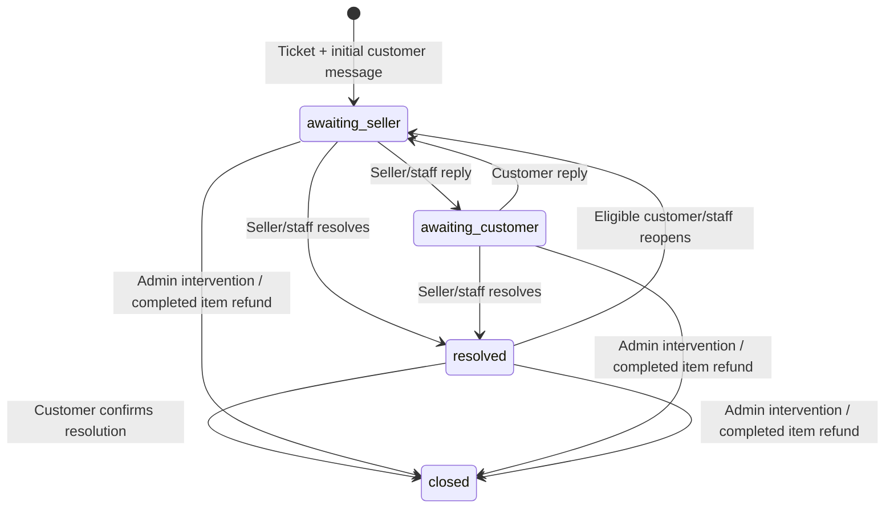

# Phase 15 — Purchase-aware product support

Templaara supports private customer ↔ seller conversations anchored to an exact verified purchased OrderItem. Tickets, messages, files and audit events are retained. Support does not change payments, refunds, earnings, payouts, licenses, entitlements or upgrade rights. Fortify, Spatie RBAC, the existing Inertia/Wayfinder application and Phases 1–14 are preserved.

## Schema and relationships

Forward migration `2026_10_06_050000_create_purchase_support.php` creates four tables. Historical migrations are unchanged.

| Table                   | Significant fields                                                                                                                                                                                                                                                                                                                                                                                                                                                               |
| ----------------------- | -------------------------------------------------------------------------------------------------------------------------------------------------------------------------------------------------------------------------------------------------------------------------------------------------------------------------------------------------------------------------------------------------------------------------------------------------------------------------------- |
| `support_tickets`       | Unique public UUID and `TMP-SUP-{year}-{ULID}` reference; customer/product/OrderItem/historical seller FKs; customer-scoped request UUID and SHA-256 fingerprint; immutable product name, purchased version, package/license type, purchased support days, paid time and support end; subject/category/priority/status; escalation and terminal-lock flags; activity/read/resolved/closed/reopened times; per-participant read sequences; increasing event sequence; timestamps. |
| `support_messages`      | Public UUID; ticket and authenticated sender FKs; controlled sender type; internal-note flag; plaintext body; request UUID/fingerprint unique per ticket/sender; unique ticket audit sequence; creation timestamp. No update/delete API.                                                                                                                                                                                                                                         |
| `support_attachments`   | Public UUID; message/uploader FKs; sanitized original name, detected MIME, positive size, SHA-256, private disk/object identity and creation timestamp. Unique disk/path; retained and immutable.                                                                                                                                                                                                                                                                                |
| `support_ticket_events` | Ticket, nullable system actor, unique per-ticket sequence, controlled type, previous/current status, optional reason and occurrence timestamp. Append-only, without mutable timestamps or copied message bodies.                                                                                                                                                                                                                                                                 |

All commercial/history references use restrictive deletion. Indexes support customer/activity, seller/status/activity, exact-item/status, overall status/priority/activity and visible ticket messages. Ticket ownership/context fields cannot be changed. Relationships link customer, historical seller, product, exact item, messages, attachments and events. No public numeric-ID route or fake official seller account is introduced.

## Eligibility and purchased terms

`SupportEligibility` centralizes the domain query; PostgreSQL `templaara_support_purchase` independently guards critical commercial relationships.

A customer needs their own completed/paid order, a paid timestamp, the recorded settled paid Payment with matching order/amount/currency, and consistent provisioned active/unrevoked/unexpired Entitlement and License. Customer/order/item/product/offer/release/artifact identities must match; the retained source package must belong to the purchased release, whose product/version must match the OrderItem. No completed refund claim may exist for that item. The item must have a valid Phase 11 seller snapshot.

Purchased `support_period_days` is authoritative. Null or zero means no included standard support; it does **not** invent unlimited support. Positive terms expire at `paid_at + support_period_days × one day`; the end is **exclusive** (`now < end`). Comparison parameters carry an explicit ISO timezone offset, avoiding implicit PostgreSQL session-timezone interpretation. Public form context shows the finite end and purchased package/version. Changing today's Product/Offer cannot rewrite purchased support rights.

Multiple purchases remain separate support contexts. Library/order links include the exact entitlement UUID; the create form resolves its immutable OrderItem. The public product entry filters eligible purchases for that product, allowing explicit selection. The selector paginates 20; it never downloads an unlimited purchase history. Ticket creation rejects another customer's item and derives customer/product/seller/context from server records.

An active case opened while support was eligible can continue to resolution after its support period expires. Public replies still require consistent active purchased access and no completed refund; period expiry alone is ignored for continuation. Reopening requires current, unexpired purchased support. Customers can always read retained history. No timed auto-close or automatic support renewal is implemented.

## Historical seller and official products

Ticket seller is the immutable OrderItem `author_user_id`, not a newly looked-up current Product owner. Future ownership transfer does not silently move existing conversations. Historical sellers remain responsible for their assigned tickets while authorized as authors with the existing product-view permission. This policy intentionally differs from Phase 14's current-owner public response policy.

Platform/Templaara purchases retain a null seller FK. Authorized users with `support.view` inspect the official queue; `support.manage` users reply/resolve/intervene publicly as **Templaara Support**. Admin replies to author products use the same explicit staff label and never impersonate the seller. No author verification or new role grants are introduced.

## Lifecycle and controls



Statuses are `awaiting_seller`, `awaiting_customer`, `resolved`, `closed`; an extra generic `open` status is unnecessary. Any authorized participant can reply while active, returning the appropriate awaiting state. Resolved tickets require explicit eligible reopening before conversation resumes. Customers close only resolved tickets. Admin close requires a reason and marks a terminal lock. Closed tickets are terminal for everyone in this phase; neither customer nor admin reopens them. Reopening a resolved ticket reuses its identity/history, clears no commercial restriction and records a timestamp/event.

Controlled categories: installation, configuration, bug, usage_question, compatibility, license_activation, update, other. Controlled priorities: low, normal, high. Customer selects an initial priority; staff may change it with audit. No refund/payment dispute/chargeback category or critical-emergency privilege exists.

A seller may request escalation with an actionable reason. Staff may escalate/deescalate with reason. The flag and corresponding actor/time/reason event provide a simple support attention mechanism; it does not trigger financial actions or impersonate assignment/reassignment. No customer escalation button, complex assignment engine or SLA automation was added.

## Workflow, messages and idempotency

`SupportWorkflow` centralizes creation, replies, notes, explicit transitions, read tracking and completed-refund closure. Ticket creation atomically saves ticket + initial message + first event; empty shells cannot commit. Messages are plaintext 1–10,000 characters. Subject is trimmed plaintext 3–200. HTML and malformed nested values are rejected; Vue uses escaped interpolation and preserves line breaks, never `v-html`.

Every message is immutable after send; no editing/deletion endpoint exists. Actor/sender type come from the authenticated participant and route context. Browser identity/status/context/internal-note fields are prohibited; dates, read state and activity are server-derived. Staff notes use a separate permission-checked endpoint, not a browser-controlled privileged flag.

Creation keys are UUIDs unique per customer; message keys are UUIDs unique per ticket/sender. Fingerprints cover normalized validated text/context plus attachment original name/detected MIME/size/content hash. Same key/same content returns the original record without another message or event, even when a successful request is retried after subsequent state changes. Same key/different content is rejected. Multiple different support issues on the same item are allowed with different keys. UUID/ULID allocation and database uniqueness prevent `count()+1` reference races.

## Private attachments and retention

Allowed types: PNG, JPEG, WebP, PDF, UTF-8 TXT and LOG. Limits default to five files and 10 MiB per file; configuration can lower these ceilings. File extension must agree with server-detected MIME. Images must have readable image headers; text rejects binary/control/script/HTML indicators; PDF rejects JavaScript/launch/embedded-file/open-action indicators. Unknown formats, executable/script/HTML/SVG and MIME/extension mismatches fail validation. ZIP was deliberately omitted rather than expanding archive handling.

These checks are conservative content/type controls, **not antivirus or a full PDF malware-analysis guarantee**. Every file is downloaded as an attachment using `application/octet-stream`, `nosniff`, private/no-store and restrictive CSP; no browser-inline file rendering or arbitrary public link is provided.

`SupportAttachments` reuses Laravel Filesystem, `PrivateArtifactStorage::assertSecure` and the existing durable `FileRetention` staging/cleanup queue. Random objects live under `support/` on a validated private local/S3 disk. Public disks, public serving/URLs/roots and private/public shared S3 buckets are rejected. Files are staged with cleanup jobs before database work; failed/conflicting/idempotent retries remove unattached objects, while the cleanup service now recognizes retained SupportAttachment references. Storage cleanup failures retain retry jobs without logging bodies/paths/secrets.

Only the ticket's customer, historical authorized seller or `support.view` staff can download its visible attachments. Internal-note files are staff-only; UUID guessing never grants access. Routes stream through an authorized controller, including for S3, rather than exposing storage paths or persistent signed URLs. Closing, refunding, unpublishing or profile changes do not delete retained files. The existing file-pruning scheduler can clean abandoned staged uploads; attached support files are protected.

Production configuration:

```dotenv
# Use a securely configured private filesystem disk.
SUPPORT_ATTACHMENT_DISK=product_s3_private
SUPPORT_ATTACHMENT_MAX_KB=10240
SUPPORT_ATTACHMENTS_MAX=5
```

Local default is the existing `product_private` disk. S3 uses the established product-storage credential/bucket configuration. `.env.example` documents local options; the user's `.env` was not changed. Align PHP/web-server upload/post limits with the chosen maximum of five files. Retention/backup/object monitoring remain operational responsibilities; no new storage provider or scanning service was installed.

## Refund completion and independent commerce boundaries

Phase 13 completion invokes `SupportWorkflow::refunded` in the same already buyer/seller-locked transaction, after item compensation/claims/access revocation. It closes every non-closed ticket tied to that exact refunded OrderItem, sets a terminal lock and appends system `purchase_refunded`. Existing closed tickets remain retained/terminal. Messages/files/audit are never deleted. Another item or a later purchase of the same product does not close/rebind this ticket.

Pending, approved, processing, failed and cancelled refunds leave support eligibility/conversation unchanged if otherwise eligible. After completed refund, no new ticket, reply or reopening is allowed for that item. History/files remain readable. Support actions never approve/complete refunds, change amounts, reverse earnings, alter payouts, revoke licenses/access, or create upgrade entitlements. Purchased version is always the historical snapshot; current release identity is not substituted.

## Workspaces and routes

| Workspace   | Routes and capability                                                                                                                                                      |
| ----------- | -------------------------------------------------------------------------------------------------------------------------------------------------------------------------- |
| Customer    | `GET /account/support`, `GET .../create`, `POST /account/support`, `GET .../{ticket:uuid}`, `POST .../{ticket}/messages`, `/close`, `/reopen`; own purchases/tickets only. |
| Author      | `GET /author/support`, `GET .../{ticket:uuid}`, `POST .../{ticket}/messages`, `/resolve`, `/escalate`; historical seller binding plus author/product permission.           |
| Staff       | `GET /admin/support`, `GET .../{ticket:uuid}` with `support.view`; POST messages/notes/resolve/close/reopen/priority/escalate/deescalate with `support.manage`.            |
| Attachments | `GET /{account,author,admin}/support/attachments/{attachment:uuid}`; exact ticket scope plus internal-note authorization.                                                  |

Existing sidebar adds My Support, author Support and permission-gated Support Tickets. Library and order items expose exact-purchase Get Support; logged-in eligible product viewers can select support context. There is no guest support creation, separate authentication or second application.

`support/Create.vue`, `Index.vue`, `Show.vue` reuse AppLayout and existing Inertia/Wayfinder/types/error/toast conventions. Conversation includes safe purchase context, visible messages/private download links, lifecycle history and capability-based reply/resolve/close/reopen/escalation. It has upload controls, validation/pending feedback, confirmations, empty state and pagination. No sockets/live-chat dependency is used.

Queues paginate 15, sorting last public message then ID descending. Customer filters status/category/product; additional priority/reference/search/date/unread/escalation filters are available. Author filters cannot broaden historical seller scope. Staff filters include customer/seller name. Author workspace displays truthful scoped open/awaiting-seller/awaiting-customer metrics; no global author dashboard or fabricated count was introduced. Conversation and history paginate 25 separately and preserve filters/page parameters.

## Read/unread and privacy

Customer/seller read timestamps are paired with audit-sequence watermarks. Read updates use the same lock boundary but do not fabricate lifecycle events. Unread counts include only visible messages from someone else with a sequence after that participant's watermark. This avoids timestamp granularity losing messages sent in the same second. Internal notes never affect participant unread counts or last public activity. Staff reads do not alter customer/seller read state; the admin attention indicator reports customer-message counts, not a claimed per-admin unread state.

`SupportPresentation` explicitly allow-lists ticket context, partial customer display name, safe seller identity, visible messages, attachment names/type/size/authenticated download route, status/capabilities and safe history. The seller never receives customer email, billing/phone, settlement/provider payloads, order numbers, amounts, license secrets/hashes, artifact/download paths, refund explanations/private notes or payout destinations. Authenticated shared props remain that user's own account data, not the customer account. Internal-note messages/files/events are excluded server-side from customer/seller projections. Staff action reasons are admin-only; participants receive only a generic purchase-refunded reason where applicable. Pagination's normal HTTP `path` is a page URL, never an object-storage path.

`SupportTicketPolicy` separates customer ownership, historical seller authority, staff viewing and staff management. Read-only permission cannot mutate. IDs are untrusted references, not credentials; scoped mismatches return 404, permission failures 403. Per-user mutation and download rate limits are 30/minute. Support workspaces use private/no-store, encrypted detail history and Inertia devtools exclusions. Validation/conflict messages are generic; no raw SQL/request payload/content/keys are logged.

## PostgreSQL integrity, audit and concurrency

Checks control status/category/priority, required fields, exact snapshot/end calculations, lifecycle timestamps, read-sequence bounds, attachment size/type/object identity and event types. Triggers protect exact customer/item/product/historical seller context, immutable identity, actor permissions, internal-note semantics, terminal closure, sender authorization, append-only messages/events and retained attachments. Deferred checks require the initial message, complete increasing event history, matching message event/actor, server-consistent last public message time and no active ticket after a completed refund. A deferred trigger on item refund claims rejects completion with non-closed support. Restrictive FKs and account/product deletion guards retain support participants/history.

Audit types: created, customer_replied, seller_replied, admin_replied, internal_note_added, resolved, closed, reopened, priority_changed, escalated, deescalated, purchase_refunded. Each domain change increments the ticket sequence and appends actor/time/state/reason inside its transaction. Escalation actor/time are represented by immutable audit events, avoiding duplicate mutable actor fields. No sensitive message body is copied into event metadata.

Lock order aligns with refunds: customer and historical seller User IDs in ascending order → Order → Ticket; replies and transitions retry deadlocks up to three times. The shared buyer/seller rows serialize creation/replies with completed refunds, preserve messages and prevent post-refund active tickets. Storage staging is outside retried database closures; database references and audit commit atomically.

The seven independent-process races verify same-key creation, customer reply versus seller resolve, seller reply versus customer close, refund versus reply, refund versus creation, two distinct seller replies, and admin terminal close versus customer reopen. Policy deliberately disallows replying to resolved tickets until reopening, so the seller-reply/customer-close race rejects the stale reply rather than silently resuming a resolved conversation. Assertions verify message counts, final state, idempotency and complete audit sequences.

## Events, retention and deferred work

Six safe-ID `ShouldDispatchAfterCommit` events: SupportTicketCreated, SupportMessageSent, SupportTicketResolved, SupportTicketClosed, SupportTicketReopened, SupportTicketEscalated. Each carries only ticket ID; rollback dispatches nothing. Initial creation represents the initial message through TicketCreated. System refund closure emits TicketClosed plus immutable purchase_refunded audit. No notifications, mail delivery or message sending integration was added.

Account deletion is blocked for retained customer/seller tickets, message senders and support audit actors. Product deletion explicitly refuses support history, with restrictive commercial/support FKs as backstops. Attachment uploader retention is also covered through its immutable sender relation/FK. No destructive support rollback is supplied. Future reviewed retention/anonymization needs a deliberate operational policy.

Deferred: support renewal, ticket assignment/reassignment, SLA/time-based auto-close, email/database notification delivery, live chat/WebSockets, AI support, helpdesk automation, public Q&A, message edits/history, customer escalation, ZIP attachments, external antivirus integration and Phase 16. No financial/provider flow was expanded.

## File inventory

Created:

- `app/Enums/SupportStatus.php`, `SupportCategory.php`, `SupportPriority.php`.
- `app/Models/SupportTicket.php`, `SupportMessage.php`, `SupportAttachment.php`, `SupportTicketEvent.php`; `app/Policies/SupportTicketPolicy.php`.
- `app/Services/Support/SupportEligibility.php`, `SupportWorkflow.php`, `SupportAttachments.php`, `SupportPresentation.php`.
- `app/Http/Controllers/Support/SupportController.php`; `routes/support.php`; `config/support.php`; the forward migration above.
- Six `app/Events/Support/Support*.php` event classes listed above.
- `resources/js/pages/support/Create.vue`, `Index.vue`, `Show.vue`; `resources/js/types/support.ts`.
- `tests/Feature/PhaseFifteenTest.php`; `tests/Support/SupportFixtures.php`, `verify-phase15-suite.php`, `verify-phase15-concurrency.php`; this document.
- Generated Wayfinder support and attachment route helpers for account/author/admin and SupportController action helpers.

Modified:

- `routes/web.php`, `app/Providers/AppServiceProvider.php`, `config/inertia.php`, `.env.example`.
- `app/Services/Refunds/RefundWorkflow.php`, `app/Services/Products/Files/FileRetention.php`, `DeleteProduct.php`, `app/Http/Requests/Settings/ProfileDeleteRequest.php`.
- `app/Services/Entitlements/LibraryPresentation.php`, `app/Http/Controllers/Account/LibraryController.php`, `app/Services/Commerce/OrderPresentation.php`, `app/Http/Controllers/MarketplaceController.php`.
- `resources/js/components/AppSidebar.vue`; `resources/js/pages/library/Index.vue`, `Show.vue`, `orders/Show.vue`, `marketplace/Show.vue`; library/commerce TypeScript types; generated route/action parent exports and build output.

No packages or role grants were installed/changed; `.env`, Fortify and existing review/financial contracts were preserved. External browser scripts remain outside application manifests, with private temporary cached config/credentials/storage and disposable fixtures.

## Verification

```sh
php artisan migrate --no-interaction
php artisan migrate:status
php artisan route:list --except-vendor
php artisan event:list
php artisan schedule:list
php artisan test --compact
php artisan test --compact --filter=PhaseFifteenTest
php tests/Support/verify-phase15-suite.php --support-only
php tests/Support/verify-phase15-suite.php
php tests/Support/verify-phase15-concurrency.php
vendor/bin/pint
vendor/bin/pint --test
npm run check:fix
npm run check
npm run types:check
npm run build
vendor/bin/phpstan analyse --no-progress
```

PostgreSQL runners require both `current_schema()` and exact `SHOW search_path` to equal the generated disposable schema before migrations/fixtures/workers. The browser router checks both on every request. Tests never run RefreshDatabase against the application's public schema, truncate commercial tables or globally disable integrity triggers. Scoped cleanup removes temporary schema/configuration/credentials/storage/symlinks afterward; application counts and schema are audited independently.

### Completed results

| Check                               | Exact completed result                                                                                                                                                                                                                                                                                                                           |
| ----------------------------------- | ------------------------------------------------------------------------------------------------------------------------------------------------------------------------------------------------------------------------------------------------------------------------------------------------------------------------------------------------ |
| Phase 15 portable suite             | 134 total: **105 passed, 29 PostgreSQL-only skipped, 313 assertions**.                                                                                                                                                                                                                                                                           |
| Isolated Phase 15 PostgreSQL        | **134 passed, zero skipped, 342 assertions**, 50.244 seconds.                                                                                                                                                                                                                                                                                    |
| Full Laravel regression             | 1,039 total: **882 passed, 157 skipped, 4,760 assertions**, 199.753 seconds; no failures. Includes all existing Phase 1–14 tests.                                                                                                                                                                                                                |
| Full isolated PostgreSQL regression | 678 total: **677 passed, one legacy skip, 2,558 assertions**, 251.777 seconds. Phase 15, 14, 13, 12, 11, 10, Commerce and Entitlement suites. The existing Entitlement partial-legacy fixture is SQLite-only because PostgreSQL forbids deleting retained commercial licenses.                                                                   |
| Independent-process concurrency     | **Seven scenarios, 34 assertions, all passed** on final rerun.                                                                                                                                                                                                                                                                                   |
| Browser                             | **All five requested flows passed**: author-product purchase/support/screenshot/replies/resolve/close; eligible reopening; exact-item refund closure/retained messages/files/revoked access; official purchase/staff response/resolve; seller privacy. Internal-note exclusion, mobile queues/conversation and no JavaScript errors also passed. |
| Pint                                | Formatter and final `--test` passed.                                                                                                                                                                                                                                                                                                             |
| Frontend                            | Formatting/lint check and TypeScript passed; final production build **2.91 seconds**.                                                                                                                                                                                                                                                            |
| PHPStan                             | Exactly one pre-existing error: `database/factories/UserFactory.php:49`, `withTwoFactor()` missing return. No Phase 15 errors; PHPStan is not reported as fully clean.                                                                                                                                                                           |
| Migration                           | New forward migration applied locally successfully and recorded as run. No seeder or application-fixture creation.                                                                                                                                                                                                                               |
| Routes/events/schedules             | All list commands completed; **193 non-vendor routes**, existing schedules preserved, no support auto-close job.                                                                                                                                                                                                                                 |
| Application cleanup                 | Final `current_schema()=public`, exact `SHOW search_path=public`; **no Phase 15 temporary schemas**. Credentials/configuration/browser storage/symlinks/screenshots removed. Only reusable external verification scripts remain. Existing user-started npm dev server preserved.                                                                 |

Final application counts remain zero for orders/items/payments, entitlements/licenses, refunds/items/compensations/events/claims, earnings/ledger, payouts/allocations/events, customer reviews/responses/events and all four support tables. The existing commission policy count remains one. Application users/catalog/products were not replaced or reset, and no synthetic commercial/support rows were inserted there.

The PostgreSQL exact-boundary case exposed an application timestamp-parameter interpretation defect; explicit offset parameters fixed it, and the affected suite plus complete regressions passed afterward. Browser retries diagnosed harness issues rather than product defects: a JPEG fixture given a PNG extension was correctly rejected, a navigation needed an explicit wait, and a paginator's normal HTTP `path` was incorrectly treated as a storage-path leak. The final harness uses the matching JPEG extension, waits for ticket navigation and checks sensitive storage identities rather than banning ordinary pagination URLs. No security validation was weakened to make browser checks pass.

Test coverage includes all eight categories/control validation, protected field forgery, paid/provisioned eligibility, exact buyer/purchase context, expiry/boundary/continuation/reopen, historical version/terms, ticket/message idempotency and conflicts, independent issues/reference uniqueness, owner-scoped reads/mutations, staff read-only restrictions, official staff identity, notes/files/privacy, supported/dangerous attachment formats/limits, complete and non-complete refunds, read sequences, retention/events/rollback, multi-role users, deterministic pagination/filters/metrics, entry links and unchanged commerce/access/financial identities. Twenty-nine direct-write PostgreSQL cases protect controlled state, commercial identity, cross-customer/product/seller inserts, message/event/file retention, initial-message/audit completeness, idempotency and attachment uploader identity.

## Completion report (40 requested points)

| #   | Deliverable             | Result                                                                                                                                                                                                                          |
| --- | ----------------------- | ------------------------------------------------------------------------------------------------------------------------------------------------------------------------------------------------------------------------------- |
| 1   | Files created           | Full inventory above: enums/models/policy/services/controller/routes/config/events/migration, Vue/types, tests/runners/documentation and generated Wayfinder helpers.                                                           |
| 2   | Files modified          | Full inventory above: refund closure, retained file cleanup, product/account retention, library/order/storefront projections, sidebar/types, routing/provider/Inertia configuration and example configuration.                  |
| 3   | Migrations              | One forward migration creates four support tables with PostgreSQL checks/guards/deferred integrity; applied locally.                                                                                                            |
| 4   | Ticket schema           | UUID/ULID reference, exact item/customer/product/historical seller, immutable support context, controlled lifecycle, activity/read/audit sequences.                                                                             |
| 5   | Message schema          | Immutable authenticated sender/type, plaintext, internal-note flag, idempotency identity and audit sequence.                                                                                                                    |
| 6   | Attachment schema       | Immutable uploader/message, sanitized name, detected type/size/checksum, private randomized object identity.                                                                                                                    |
| 7   | Audit schema            | Append-only sequenced actor/state/time/reason history; no copied sensitive message payload.                                                                                                                                     |
| 8   | Lifecycle               | Awaiting seller ↔ awaiting customer → resolved → eligible reopen or terminal close.                                                                                                                                             |
| 9   | Categories/priorities   | Eight product-support categories; low/normal/high; no financial-dispute or critical-emergency category.                                                                                                                         |
| 10  | Qualification           | Real paid/completed reconciled purchase and provisioned consistent active access, exact item and no completed refund.                                                                                                           |
| 11  | Support period          | Purchased positive days, exclusive exact end; null/zero do not imply unlimited; active conversations may finish after expiry.                                                                                                   |
| 12  | Refund interaction      | Only completion closes exact-item non-closed tickets in the compensation transaction; retained history/files, no reverse financial coupling.                                                                                    |
| 13  | Seller binding          | Historical OrderItem author snapshot, not silently reassigned with current product ownership.                                                                                                                                   |
| 14  | Official products       | Null seller binding; permission-authorized real staff reply publicly as Templaara Support.                                                                                                                                      |
| 15  | Customer workspace      | Eligible purchase selection, exact library/order/product entries, private queue/conversation/files/close/reopen.                                                                                                                |
| 16  | Author workspace        | Historical seller-scoped queue, truthful counts, visible conversation/files/reply/resolve/escalation.                                                                                                                           |
| 17  | Admin workspace         | support.view inspection and support.manage replies/notes/intervention/priority/escalation; scoped filters and pagination.                                                                                                       |
| 18  | Messages                | Immutable plaintext, no edit/delete endpoints, server-derived actors/activity.                                                                                                                                                  |
| 19  | Internal notes          | Separate staff-only endpoint/projection/download authorization; excluded from participant messages/audit/unread/activity.                                                                                                       |
| 20  | Attachments             | PNG/JPEG/WebP/PDF/TXT/LOG; type/content checks, maximum five × 10 MiB, private durable staging/retention.                                                                                                                       |
| 21  | Downloads               | Authenticated exact ticket scope and internal-note visibility; streamed private files with attachment/nosniff/no-store headers, no object paths.                                                                                |
| 22  | Escalation              | Explicit seller request or staff escalate/deescalate with reason and immutable actor/time audit.                                                                                                                                |
| 23  | Read/unread             | Server timestamps plus sequence watermarks; visible messages from other senders only; same-second messages preserved.                                                                                                           |
| 24  | Privacy                 | Explicit support DTOs omit customer contact/financial/license/artifact/refund-private/payout data from seller.                                                                                                                  |
| 25  | Authorization/IDOR      | Central policy, separate participant/staff modes, UUID routes, 404 for scoped mismatch, read-only cannot mutate, throttling.                                                                                                    |
| 26  | PostgreSQL              | Controlled values, exact identity/snapshot, timestamp/terminal/refund checks, immutable messages/files/audit, required initial message and complete matching history.                                                           |
| 27  | Idempotency             | Database uniqueness plus canonical content/file fingerprints; identical replay returns original, changed payload rejects.                                                                                                       |
| 28  | Locking                 | Ascending buyer/seller Users → Order → Ticket, three retry attempts, compatible with refund completion.                                                                                                                         |
| 29  | Events                  | Six safe-ticket-ID after-commit events; no notifications/delivery.                                                                                                                                                              |
| 30  | Retention               | Account/product guards and restrictive FKs retain customer/seller/actor/file/history; destructive rollback refused.                                                                                                             |
| 31  | Tests                   | 134 meaningful Phase 15 dataset cases, including 29 PostgreSQL-only direct-write cases; previous tests retained.                                                                                                                |
| 32  | PostgreSQL verification | Phase 15 134/134 passed, 342 assertions; full 677 passed/one legacy skip, 2,558 assertions.                                                                                                                                     |
| 33  | Concurrency             | Seven independent-worker scenarios passed, 34 assertions.                                                                                                                                                                       |
| 34  | Browser                 | All requested customer/author/refund/official/privacy flows passed; mobile and no JavaScript errors.                                                                                                                            |
| 35  | Full regression         | Laravel 882 passed/157 skipped/4,760 assertions; full PostgreSQL includes all required prior commerce/financial/access phases.                                                                                                  |
| 36  | Formatter/frontend      | Pint, formatting/lint, TypeScript and production build passed.                                                                                                                                                                  |
| 37  | PHPStan                 | Only known UserFactory::withTwoFactor error remains, no new errors.                                                                                                                                                             |
| 38  | Known issues            | Pre-existing PHPStan missing return and optional fontaine fallback warning. Type/content validation is not an antivirus guarantee.                                                                                              |
| 39  | Deferred                | No Phase 16, notifications, live chat, AI, public Q&A, SLA/renewal/assignment automation or financial expansion.                                                                                                                |
| 40  | Decisions               | Exact-item immutable context, historical seller, exclusive finite support, continuation after expiry, terminal close, orthogonal staff notes, private retained files, idempotent append-only conversation and compatible locks. |

Phase 15 is complete. Stop here; Phase 16 has not begun.
