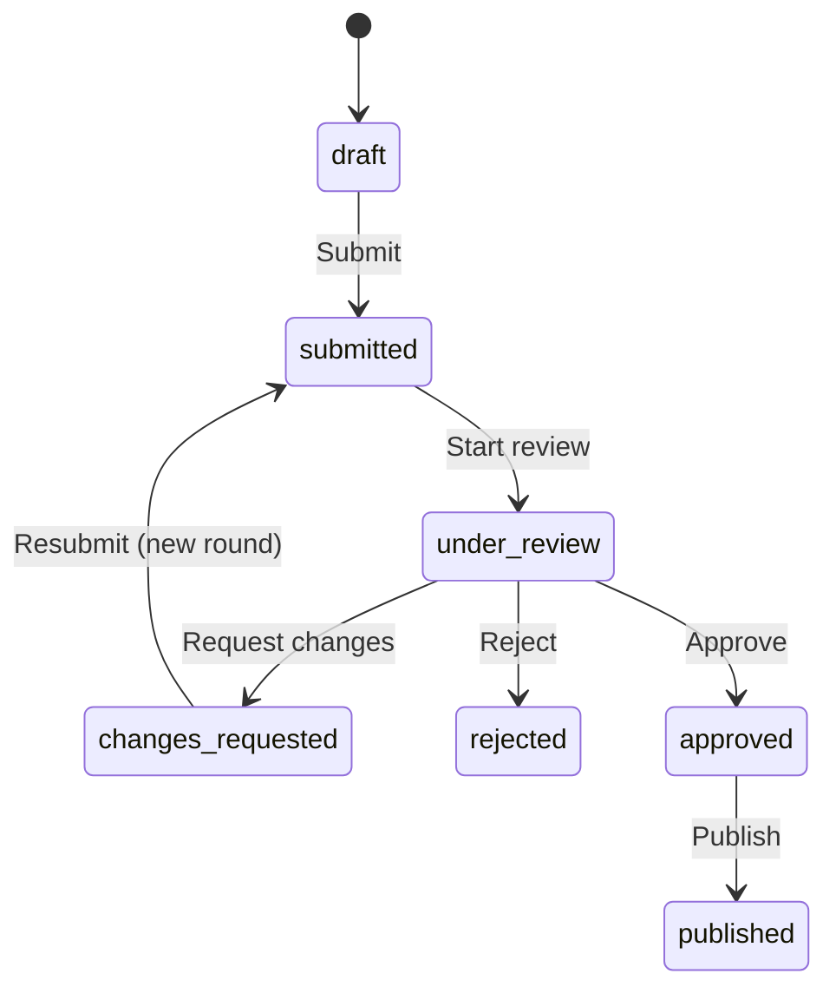

# Phase 4: Product submission and review

Phase 4 adds private product moderation to the existing Laravel 13.34.0, PostgreSQL, Fortify, Spatie Permission 8.3.0, Vue 3.5.43, Inertia and Wayfinder application. Phases 1–3, existing authentication, catalog architecture and permission assignments are preserved. No packages or application-manifest dependencies were added.

## Lifecycle

`ProductStatus` is a string-backed enum. PostgreSQL enforces the same seven values through a new migration, leaving the applied Phase 3 migration unchanged.



| Action            | Allowed starting state   | Result            | Required capability                                                  |
| ----------------- | ------------------------ | ----------------- | -------------------------------------------------------------------- |
| Submit / resubmit | draft, changes_requested | submitted         | products.submit plus ownership, or official-product admin management |
| Start review      | submitted                | under_review      | products.review; actor cannot own the author product                 |
| Request changes   | under_review             | changes_requested | products.review + products.soft-reject; assigned reviewer            |
| Reject            | under_review             | rejected          | products.review + products.reject; assigned reviewer                 |
| Approve           | under_review             | approved          | products.review + products.approve; assigned reviewer                |
| Publish           | approved                 | published         | admin membership + products.publish                                  |

`changes_requested` is a correction opportunity, not permanent rejection. The existing `products.soft-reject` permission retains its name for backward compatibility. Rejection is terminal in this phase. There are no reopen, withdraw, unpublish or reassignment actions.

**Published is a recorded lifecycle state only.** No public product pages, product APIs, storefront exposure or purchasing functionality were created. Active/featured flags do not bypass the workflow.

## Centralized transition service

`App\Services\Products\Workflow\ProductWorkflow::transition()` accepts an authenticated actor, product, controlled action enum, optional submission ID and action input. It:

1. Starts a transaction and refetches/locks the product row.
2. Authorizes the action through ProductPolicy against the locked product.
3. Validates action input and the allowed state transition.
4. Locks the latest review round and rejects stale-round actions.
5. Validates submission readiness when submitting, approving or publishing.
6. Creates a round or records its claim/decision, inserts actionable feedback where required, changes status, and appends an audit event atomically.
7. Dispatches the corresponding domain event only after commit.

Controllers do not assign statuses. Phase 3 SaveProduct initializes new products as drafts; its existing updates lock the same product row and reauthorize after locking. Product edit requests prohibit status, ownership and origin. Workflow records are guarded against ordinary mass assignment; actor IDs come exclusively from the authenticated actor.

Duplicate submissions, resubmissions, claims, decisions and publication return actionable validation errors, normally HTTP 422 for JSON or Inertia validation errors after redirect. Permission failures are HTTP 403. One transaction cannot partially change status without recording its round and audit event.

## Migration and schema

Migration: `database/migrations/2026_10_05_140000_create_product_review_workflow.php`.

It replaces PostgreSQL's `products_draft_status` constraint with `products_status` accepting the enum values and creates three tables.

### product_submissions

- Bigint ID, restrictive product FK.
- Positive integer `round_number`; unique `(product_id, round_number)`.
- Restrictive `submitted_by` user FK and required timezone-aware `submitted_at`.
- Nullable restrictive `reviewed_by` user FK and `review_started_at`.
- Nullable controlled decision: changes_requested, rejected, approved.
- Nullable `decision_at` and text `decision_summary`.
- Smallint `snapshot_version`, initially 1; required JSONB `snapshot`.
- Timezone-aware created/updated timestamps.
- Indexes on submission date/ID and reviewer/decision.
- PostgreSQL partial unique index allows at most one undecided round per product; CHECK constraints enforce positive rounds, valid decisions and decision/time presence consistency.

Every resubmission creates a new round. Submitter, submission time, identity and content snapshot are immutable. An open round permits recording its reviewer claim and final decision. Once decided, the entire round is immutable.

`ProductSubmission` belongs to Product, submitter and reviewer and has ordered feedback. Product has submissions ordered newest round first.

### product_review_feedback

- Bigint ID, restrictive submission FK.
- Controlled section, default general, and required message text.
- Restrictive `created_by` user FK.
- Timezone-aware timestamps.

`ProductReviewFeedback` belongs to its submission and creator. Sections: general, basic_information, business_details, features, pricing, demo, technical, support, seo. No severity layer was added because actionable sections/messages are sufficient at this stage.

Request Changes requires 1–30 items. Each message is 10–5000 characters; each section must be recognized. Optional overall summary is at most 5000 characters. Reject requires a 10–5000 character reason. Approve accepts an optional summary. Nested feedback permits only section/message, so forged creator IDs are rejected.

### product_lifecycle_events

- Bigint ID; restrictive product, submission and actor FKs.
- Action, previous status, resulting status.
- Required timezone-aware `occurred_at`, created/updated timestamps.
- Index `(product_id, occurred_at, id)`.

`ProductLifecycleEvent` belongs to Product, submission and actor. It records every successful submit, start, request-changes, reject, approve and publish transition. Publication actor/time are represented by the publish event; duplicated publisher columns on Product are unnecessary.

## Content snapshots and durable history

Each round stores a versioned JSONB snapshot of the submitted business content, catalog names/IDs, features, offers, currency and demo/technical/support/SEO details. The normalized live Product, features, offers and catalog relationships remain authoritative for editing; JSONB here serves the independent requirement to preserve exactly what reviewers evaluated. A new round takes a new snapshot after corrections.

Reviewer detail presents this frozen snapshot instead of an editable form. Earlier rounds retain their original content even if authors subsequently edit current features, offers or business fields. Demo credentials are intentionally dedicated demo information and are present only in authorized detailed views/snapshots, never queue or product-list responses. Actor records expose only ID/name in history.

Model hooks prohibit deletion or modification of audit events/feedback and protect submission identity/snapshots/closed rounds. PostgreSQL triggers independently enforce these restrictions, including query-builder/raw SQL rewrites. Restrictive foreign keys retain products/users needed for history. Account deletion now returns a clear validation error for moderation actors before logout/deletion. Drafts without submissions retain Phase 3 deletion behavior.

Migration rollback refuses to erase retained workflow history or remove non-draft statuses on PostgreSQL. Operational retention, account anonymization and privileged archival are future deliberate policies, not destructive cascades.

## Submission readiness versus draft validation

Phase 3 useful-draft validation is unchanged. Full descriptions, audiences, benefits, features, tags and demo details can still be absent from a saved draft. `SubmissionReadiness` separately requires:

- Product name, valid backend slug and active primary category; product itself must be active.
- Short description of at least 30 characters, full description of at least 50, business problem/solution of at least 20.
- At least one target audience (minimum 3 characters) and benefit (minimum 5).
- At least one feature with a meaningful title (minimum 3).
- At least one industry and one technology; every selected catalog record must currently be active.
- At least one active offer and exactly one default offer which is active.
- Valid controlled currency (INR/USD/EUR/GBP), configured offer names/license types, nonnegative decimal money with at most two fractional digits, and bounded nonnegative optional support/update periods.
- A required HTTP/HTTPS live-demo URL. A working demo is the Phase 4 marketplace policy for evaluating complete business software; URL syntax is validated and the reviewer evaluates accessibility/functionality. The server does not probe arbitrary demo URLs.
- Documentation URL, SEO fields, demo credentials and version label remain optional.

Existing upper limits from ProductRequest are retained for submission fields. Validation returns field-specific guidance such as “Add at least one target industry before submitting.” No screenshots, source packages or uploaded documentation are required because those modules do not exist yet.

Readiness is rechecked before approval and publication, catching catalog deactivation since submission. Content edits are locked out during review, and the reviewer uses the submitted snapshot. Catalog deactivation remains a separate catalog operation; publication does not automatically reactivate catalog records.

## Authorization and editability

ProductPolicy is authoritative. Role-name checks are limited to existing ownership/admin-management concepts and the deliberately admin-only publish capability; moderation uses Phase 1 permissions. No permissions were renamed or added, and no global admin bypass was introduced.

| State                         | Author/admin content edits                                   | Product deletion                     |
| ----------------------------- | ------------------------------------------------------------ | ------------------------------------ |
| draft                         | Permitted with Phase 3 permission and ownership/admin policy | Permitted with draft deletion policy |
| changes_requested             | Permitted with update permission and ownership/admin policy  | Denied to preserve review history    |
| submitted, under_review       | Denied                                                       | Denied                               |
| rejected, approved, published | Denied                                                       | Denied                               |

Administrators follow the same content freeze as authors. A reviewer receives no content ownership/edit rights. Authors cannot review/approve their own author-origin product even when they also have reviewer/admin capabilities. Customers have no product-management or moderation access. Author submission requires author origin and authenticated ownership; the admin submit endpoint is limited to ownerless official products.

Workflow payloads prohibit status, decision, product/submission identifiers and all actor/publisher/reviewer identifiers. Route-bound IDs are checked against the locked product's current round. Phase 3 nested feature/offer ownership checks, protected fields and category/catalog deletion protection remain in place.

## Reviewer claim and concurrency

Starting review claims a submitted round for the authenticated reviewer. Only the reviewer who claimed it can request changes, reject or approve. Other reviewers/admins may inspect it but cannot take over its decision. No reassignment was implemented.

Product and latest-round row locks serialize workflow requests. Existing SaveProduct/Destroy operations lock the product and reauthorize, preventing a queued author edit from passing after submission. New-round uniqueness and PostgreSQL's one-open-round index provide additional integrity protection.

Multi-process PostgreSQL verification held a product row lock, released two waiting workers, and checked each pair: duplicate submit, competing review claims, competing approve/reject decisions, and duplicate publish. Each pair produced exactly one committed transition and one validation conflict. Old-round endpoints also reject stale requests after resubmission.

## Author, reviewer, admin and official workflows

**Author:** My Products shows every lifecycle label as a status badge, with policy-specific View, Edit, Delete, Submit for Review or Resubmit actions. Saved product detail shows current status, submission/reviewer dates, decisions, actionable feedback and previous rounds. Changes Requested feedback is highlighted on both detail and editor. Authors save corrections and then resubmit from saved detail/list; unsaved editor data is never implicitly submitted.

**Reviewer:** Product Reviews is added to the existing sidebar when products.review is granted. The queue shows the latest round per product, supports status/origin/category/author/search/submission-date filters and paginates 15 records. Start Review claims a submitted round. The detail page displays business-first read-only content and separate decision controls, including repeatable section/message feedback inputs.

**Admin:** Can inspect all products/reviews, claim review rounds, record authorized decisions on rounds they claimed, and publish approved products. Publication remains separate from approval. Admins cannot override another reviewer's claim or edit frozen product content.

**Templaara Official:** Ownerless official drafts use exactly the same readiness, submission, claim, decision and publication path. No automatic approval/publication shortcut exists. A privileged admin may perform all internal stages because official products have no personal owner; separation of internal duties is not mandated in this phase. The same policy blocks an administrator from reviewing their own author-origin product. This official workflow is covered by an end-to-end backend test.

## Routes

Existing Phase 3 routes remain. New routes in `routes/products.php` all require authentication, email verification and the appropriate policy checks:

| Method | Path                                        | Route name                    |
| ------ | ------------------------------------------- | ----------------------------- |
| POST   | /author/products/{product}/submit           | author.products.submit        |
| POST   | /admin/products/{product}/submit            | admin.products.submit         |
| POST   | /admin/products/{product}/publish           | admin.products.publish        |
| GET    | /admin/product-reviews                      | admin.product-reviews.index   |
| GET    | /admin/product-reviews/{submission}         | admin.product-reviews.show    |
| POST   | /admin/product-reviews/{submission}/start   | admin.product-reviews.start   |
| POST   | /admin/product-reviews/{submission}/changes | admin.product-reviews.changes |
| POST   | /admin/product-reviews/{submission}/reject  | admin.product-reviews.reject  |
| POST   | /admin/product-reviews/{submission}/approve | admin.product-reviews.approve |

Review queue/detail routes require products.review. Decision endpoints additionally authorize their specific capability and claim inside the transition transaction. Existing admin product-group management policy remains on submit/publish routes.

## Vue pages, performance and feedback

New pages: `product-reviews/Index.vue`, `product-reviews/Show.vue`.

New shared components: `ProductSummary.vue`, `ReviewHistory.vue` under components/products. They reuse starter-kit UI and existing AppLayout, permission helpers, Inertia forms, Wayfinder and toast conventions. No duplicate app/sidebar or state-management library was introduced.

Existing products/Form and products/Index gain statuses, submission/resubmission actions and review history. Show uses ProductSummary rather than a disabled editor. Review presentation orders business details, features, industries and offers before demo and technologies; support/update periods remain correctly attached to offers. Existing editor support/update inputs are preserved.

Lists avoid snapshots/full descriptions/demo credentials and eager-load only required category, owner and reviewer identities. History selects round metadata without snapshots, eager-loads feedback/actors, and separately paginates rounds (10, rounds_page) and events (20, events_page), preserving access to all prior history. Frozen content loads only for the requested review-detail round. Queue uses the unique product/round index for latest-round selection. No external search engine or cache layer was added.

Forms provide processing/disabled states, validation summaries, field errors, successful-action flash toasts, empty states and pagination. Frontend checks govern visibility only; every backend operation independently authorizes and validates.

## Domain events and notifications

Implemented after-commit domain events:

- ProductSubmitted
- ProductReviewStarted
- ProductChangesRequested
- ProductRejected
- ProductApproved
- ProductPublished

All extend ProductWorkflowEvent and carry product/submission/actor IDs and previous/resulting enum statuses. They use ShouldDispatchAfterCommit; encompassing-transaction rollback removes writes and dispatches no event. Listeners may later implement notifications without changing workflow controllers.

No notification storage, mail listeners, external providers, queues or email infrastructure were added. The database audit tables are durable history; domain events are synchronous extension points, not a transactional outbox or guaranteed asynchronous delivery system.

## Factories and seeding

Phase 3 Product/Feature/Offer factories and idempotent development seeders remain unchanged. No automatic submission or historical review seed is created. ProductWorkflowTest builds readiness fixtures from existing factories and seeds the unchanged RolesAndPermissionsSeeder. Isolated browser verification seeded roles and business catalog before creating disposable accounts/products.

## Testing and verification

`tests/Feature/ProductWorkflowTest.php` adds **47 executed cases**, including data sets for readiness, inactive catalog, editability, permissions and forged actor fields. Coverage includes submission, ownership, customer denial, duplicate/stale transitions, claims, actionable changes, successful author corrections/resubmission, old snapshot/feedback retention, rejection, approval versus publication, official workflow, policy freezes, history/actor timestamps, queue filters, account retention, immutable history, controlled payloads, all six events and encompassing-transaction rollback. PostgreSQL-only verification checks valid/invalid statuses and database-level immutable-history enforcement.

Commands executed:

```sh
php artisan wayfinder:generate --with-form
php artisan migrate --no-interaction
php artisan route:list --path=product --except-vendor
vendor/bin/pint
vendor/bin/pint --test
php artisan test --compact --filter=ProductWorkflowTest
php artisan test --compact
composer types:check
npm run check:fix
npm run check
npm run types:check
npm run build
```

Additional verification used temporary scripts outside the repository for isolated PostgreSQL tests, multi-process row-lock contention and Playwright browser checks. No tooling dependencies were added to application manifests. Temporary private credentials/configuration and disposable schemas are removed after verification.

For repeatable local checks use Pint, php artisan test, npm run check, npm run types:check and npm run build. The default PHPUnit configuration uses SQLite in memory for portable tests. For database-constraint tests, configure a **dedicated disposable PostgreSQL testing database** in a private test configuration and run ProductWorkflowTest. RefreshDatabase can rebuild that database; use a database created specifically for tests. The isolated-schema verification performed during implementation instead migrated a random schema and rolled back each test, leaving application tables/data intact.

Results:

| Check                                    | Result                                                                                 |
| ---------------------------------------- | -------------------------------------------------------------------------------------- |
| Full Laravel suite, including Phases 1–3 | **171 passed, 4 skipped, 1067 assertions**                                             |
| Isolated PostgreSQL workflow suite       | **47 passed, 284 assertions**                                                          |
| PostgreSQL concurrent workers            | All four transition-contention scenarios passed                                        |
| Migration                                | Applied successfully; subsequent run reports nothing to migrate                        |
| Pint                                     | Passed                                                                                 |
| Frontend lint/format checks              | Passed                                                                                 |
| TypeScript                               | Passed                                                                                 |
| Production build                         | Passed                                                                                 |
| Browser workflow                         | Submit → claim → two feedback items → edit/resubmit → claim → approve → publish passed |
| Browser rejection                        | Separate rejection and author decision visibility passed                               |
| Browser JavaScript errors                | None; final author/reviewer/admin inspection checks also passed                        |
| PHPStan                                  | Only the known pre-existing empty UserFactory::withTwoFactor() missing return          |

Three existing full-suite skips concern disabled Fortify features; the fourth is PostgreSQL-only constraint verification skipped under SQLite and exercised successfully in PostgreSQL. The optional fontaine font-fallback build warning remains. The workspace has no Git repository for baseline/diff review. No Phase 4 PHPStan errors remain.

## File inventory

Created:

- `app/Enums/ProductWorkflowAction.php`, `ProductReviewDecision.php`, `ProductFeedbackSection.php`.
- `app/Models/ProductSubmission.php`, `ProductReviewFeedback.php`, `ProductLifecycleEvent.php`.
- `app/Services/Products/Workflow/ProductWorkflow.php`, `WorkflowInput.php`, `SubmissionReadiness.php`, `ProductReviewWorkspace.php`.
- `app/Events/Products/ProductWorkflowEvent.php` and the six named event classes above.
- `app/Http/Requests/Products/Workflow/WorkflowRequest.php`.
- `app/Http/Controllers/ProductWorkflowController.php`, `Admin/ProductReviewController.php`.
- `database/migrations/2026_10_05_140000_create_product_review_workflow.php`.
- `resources/js/pages/product-reviews/Index.vue`, `Show.vue`.
- `resources/js/components/products/ProductSummary.vue`, `ReviewHistory.vue`.
- `resources/js/types/product-review.ts`.
- `tests/Feature/ProductWorkflowTest.php`.
- This document.

Modified:

- `app/Enums/ProductStatus.php`.
- `app/Models/Product.php` (history relationships).
- `app/Policies/ProductPolicy.php` (workflow permissions and explicit editability).
- `app/Services/Products/ProductEditor.php` (status filters, policy flags and shared history/actions).
- `app/Http/Requests/Settings/ProfileDeleteRequest.php` (clear account-retention validation).
- `routes/products.php`.
- `resources/js/pages/products/Index.vue`, `Form.vue`.
- `resources/js/components/AppSidebar.vue`.
- `resources/js/lib/products.ts`, `resources/js/types/product.ts`.
- Regenerated Wayfinder route/action helpers and production build assets.

## Future boundaries and deliberate decisions

No media/package uploads, versions, downloads, public product pages, storefront, cart, checkout, orders, payments, customer licensing, commissions/payouts, customer reviews or support tickets were implemented.

Future upload modules must expand submission readiness and frozen review snapshots to reference immutable media/artifact versions. Future published-product updates need a separate proposed revision/version rather than direct edits to approved content. Existing version_label is still descriptive metadata, not a version-management domain.

Future storefront exposure needs explicit public serialization, visibility rules, safe demo presentation and publication queries; published state alone creates no endpoint here. New lifecycle transitions, reviewer reassignment, archival/anonymization and notification delivery should be designed and audited deliberately. The current frozen snapshot has a version field so schema evolution can be handled explicitly. Retained history contains deliberate demo credentials and should follow future retention/access decisions.

Phase 4 is complete. Development stops before Phase 5.
