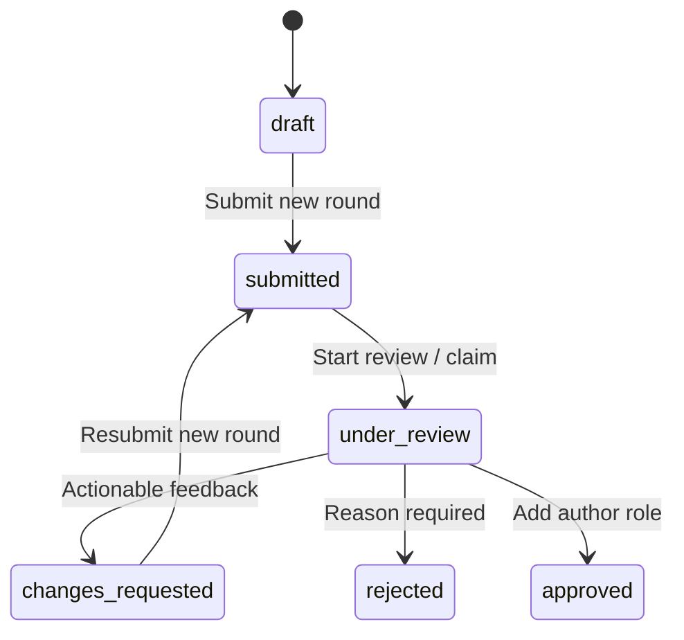

# Phase 9 — Author onboarding and marketplace approval

## Scope and compatibility

Templaara now supports Customer → Author Application → marketplace approval → Author Dashboard in the existing Fortify, Laravel, Vue, Inertia, Wayfinder and Spatie application. There is one User identity and no separate author authentication. Registration still atomically grants only `customer`. No package was installed and `.env` was not changed.

The author role denotes marketplace author approval, not government identity/KYC verification. Existing manually assigned authors retain their products, permissions and workspace access without migration, role revocation or fabricated application history. This is an explicit grandfathering exception; onboarding is the new customer-facing route to obtaining the role. Privileged operational role assignments remain outside this module.

Profile images, public author stores, financial details, KYC uploads, earnings, commissions, payouts, activation APIs, refunds and product-update entitlements are deferred.

## Schema and relationships

Migrations:

- `2026_10_05_210000_create_author_onboarding.php`.
- `2026_10_05_211000_strengthen_author_decision_integrity.php`.

### AuthorProfile

`author_profiles` is one-to-one with User through a unique restrictive `user_id`. It contains nullable draft fields: display name (150), company name (200), controlled author type (`individual`, `company`), ISO alpha-2 country, bio (5000 validation limit), HTTP/HTTPS website/portfolio/GitHub/LinkedIn URLs (2048), support email and phone (40). Unique slug (200), persisted controlled `status`, explicit `is_legacy` and timestamps are required. Status/ID and type/country indexes support queries.

Nullable content deliberately permits incomplete drafts. Slug is generated even for an unnamed draft, using the account name and the existing `UniqueSlug` helper. It is a foundation for future human-readable author stores, not a public route in this phase. Manual slugs use lowercase ASCII letters/numbers separated by hyphens. Backend uniqueness and collision suffixes are authoritative; generated races retry in fresh transactions. Updates preserve the existing slug when omitted or blank. Support email never changes the account authentication email.

User has `authorProfile()`. Profile belongs to User and has applications ordered newest round first. Profile ownership and legacy classification are immutable. Profile content is editable only in draft/changes_requested. All submitted, reviewed, rejected and approved content is frozen, including contact fields. A future controlled profile-change workflow must handle post-approval maintenance and identity changes explicitly.

Legacy authors without a profile can set one up once through `/author/profile`. That row is marked `is_legacy=true`, `status=approved`, reflecting pre-existing role eligibility; no approval application, reviewer, snapshot or event is invented. Their first save can be incomplete and does not affect product permissions. After that save the profile is frozen. Visiting any onboarding/profile screen alone does not create records or assign roles.

### AuthorApplication

`author_applications` has restrictive User/Profile references, positive round number unique per profile, submitted time, controlled status, nullable restrictive reviewer reference/review-start time, nullable decision time/summary, snapshot version 1 and JSONB snapshot, plus timestamps. Indexes cover status/submission/ID, applicant and reviewer. A PostgreSQL partial unique index permits one submitted/under-review round per profile.

No draft application round is created: drafts live in Profile. Every submission/resubmission creates a new frozen round from current profile content. Each round progresses submitted → under_review → one terminal decision. The Profile status is the authoritative current onboarding state; deferred PostgreSQL integrity checks ensure it agrees with the latest round.

The snapshot explicitly includes submitted identity, author type, country, bio, URLs, support contact and slug. It excludes login email, roles, permission records, credentials and secrets. JSONB preserves exactly what was evaluated while ordinary editable profile data remains relational. PostgreSQL compares initial snapshot content with the submitted Profile. Admin review presents frozen content; previous rounds do not follow later edits.

### Feedback and audit

`author_application_feedback` references its application and authenticated creator with restrictive foreign keys, section, message and timestamps. Controlled sections: general, identity, profile, company, portfolio, contact. Request Changes requires 1–20 items, each with an actionable 10–5000 character message. Nested input accepts only section/message.

`author_application_events` references its application and actor, and records action, prior/resulting state, occurred time and timestamps. Actions: submitted, resubmitted, review_started, changes_requested, rejected, approved. Actor IDs remain in durable audit storage; private history presentation shows actor names without exposing their emails.

Application snapshots, claims, decided rounds, feedback and events are immutable. Audit/feedback rows cannot be updated/deleted. Old feedback remains attached to the original round after corrections. Restrictive references prevent cascade deletion of applicants/reviewers/history.

## Lifecycle and concurrency



Approved and rejected are terminal for onboarding. There is no reopen, withdrawal, reassignment or reviewer override.

`AuthorWorkflow` centralizes transitions. It locks applicant User → Profile → latest Application, reauthorizes against locked state, validates action data and the current round, then records round/decision/feedback/profile state/audit atomically. `SaveAuthorProfile` uses the same User → Profile lock order and reauthorizes after locking. Unique profile/round/open-round keys provide additional database protection. Three transaction attempts handle deadlocks; stale/duplicate actions return useful validation errors or policy denial.

Start Review claims a submitted round. Only that authenticated actor can decide it; another administrator can inspect but cannot take over. Self-review is forbidden regardless of admin role or direct verification permissions. Old round URLs cannot decide a newer resubmission.

Approval revalidates the frozen snapshot and applicant's current account-email verification, then uses `assignRole('author')` inside the same transaction. Customer and unrelated legitimate roles/direct permissions survive. No destructive `syncRoles` or generalized user-role editor exists. Any failure rolls back role, status and audit together.

PostgreSQL guards additionally enforce controlled states, claim/time and decision/time consistency, rejection reason, snapshot/ownership immutability, valid transitions and audit actor/state references. Deferred constraint triggers require feedback for changes_requested, profile/latest-round agreement, audit for each transition and an existing author-role assignment for approval. They validate final transactional state rather than demanding a dangerous order of partially committed writes. Rollback of these retained-history migrations is intentionally refused; use forward migrations.

## Draft versus submission validation

Draft saves allow absent profile fields but validate supplied values, lengths, enum, controlled ISO country, email, slug and HTTP/HTTPS URLs. Country validation reuses the Phase 7 list extracted into `App\Support\Countries`; checkout's accepted values remain unchanged.

Submission separately requires:

- Display name of at least two characters.
- Individual/company type and valid country.
- Bio of at least 50 characters.
- Valid support email.
- Company name for a company applicant.
- At least one website, portfolio or GitHub URL. LinkedIn alone is insufficient under this policy.

The server provides actionable field errors. No bank, payout, tax, government identity document or image upload is required. URL syntax is validated but remote sites are not fetched or claimed verified.

Both profile/workflow inputs prohibit ownership, actor/reviewer/creator, status, role/permissions, round, snapshot and approval/decision timestamp fields. Only allow-listed profile fields are persisted. Service authorization and database guards remain authoritative; button visibility is never authorization.

## Email verification and authentication

Inspection found that Fortify email verification was disabled and User does not implement `MustVerifyEmail`; earlier `verified` middleware is therefore permissive. Phase 9 enables Fortify's existing email-verification routes/view and adds a targeted `RequireAuthorEmailVerification` check for onboarding and admin application review. It uses the existing inherited User verification methods, existing signed links and resend throttling. New applicants request a verification link from the new `auth/VerifyEmail.vue` screen before onboarding. Registration does not introduce automatic verification mail or author assignment.

The User authentication contract is unchanged, so existing customer/workspace verification behavior is not globally rewritten. Legacy authors retain existing author workspace/profile access without a verification retrofit. New applicants must have a verified account email before profile creation, submission and approval; reviewers must have a verified email before claims/decisions. Changing login email during review invalidates approval until the new email is verified. Support email is independent.

Only account-email verification uses existing Laravel notification delivery and the application's configured mail transport. No author-workflow email listener, external mail provider or KYC verification was installed. Local log mail transport can be used to inspect signed verification links; production must configure working existing account mail delivery.

## Routes and permissions

| Method  | Path                                               | Boundary                                                                          |
| ------- | -------------------------------------------------- | --------------------------------------------------------------------------------- |
| GET     | `/author/onboarding`                               | Authenticated new applicant; targeted account verification, legacy compatibility. |
| PUT     | `/author/onboarding`                               | Save authenticated user's profile only.                                           |
| POST    | `/author/onboarding/submit`                        | Own editable non-author profile, ready content.                                   |
| GET     | `/author`                                          | Existing author role; owner-scoped dashboard.                                     |
| GET/PUT | `/author/profile`                                  | Existing author role; initial legacy setup or read-only approved profile.         |
| GET     | `/admin/author-applications`                       | `authors.view`, verified actor.                                                   |
| GET     | `/admin/author-applications/{application}`         | `authors.view`, verified actor; frozen selected round.                            |
| POST    | `/admin/author-applications/{application}/start`   | `authors.view` + `authors.verify`, no self-review.                                |
| POST    | `/admin/author-applications/{application}/changes` | Same permissions, current claimed round.                                          |
| POST    | `/admin/author-applications/{application}/reject`  | Same permissions, current claimed round, reason.                                  |
| POST    | `/admin/author-applications/{application}/approve` | Same permissions, current claimed round, readiness.                               |

No permission was created or reseeded differently. Admin already has authors.view/manage/verify. Existing reviewer has authors.view only and can inspect, not decide. An explicit authors.verify grant enables the workflow without assuming a role name. `authors.manage` is reserved for later approved-seller management; it does not substitute for verification authority.

## Vue workspace and navigation

Created pages: `authors/Onboarding.vue`, `Applications.vue`, `Review.vue`, `Dashboard.vue`, plus the existing-auth-layout `auth/VerifyEmail.vue` verification prompt. Shared `AuthorSnapshot` and `ApplicationHistory` components present escaped read-only content and private history. They reuse AppLayout, UI Button/Input/Label, Inertia forms/errors/toasts and Wayfinder; no new layout or state-management dependency exists.

Onboarding has basic information, about, online presence and support sections; country names use browser Intl.DisplayNames. Draft/changes_requested expose saving and submit/resubmit only after saved changes. Submitted/under-review show read-only history; changes feedback is highlighted; rejected shows reason; approved/legacy show Author Dashboard. External links allow only HTTP/HTTPS and use noopener/noreferrer.

Admin queue shows the latest round per profile, paginates 15 and preserves search/status/type/country/submission-date filters. Search is escaped and bound over frozen display/company names and authorized account email. Detail shows submitted snapshot, account identity, reviewer, current decision controls and previous rounds. History paginates ten rounds with bounded feedback and audit records; relationships are eager-loaded. The one-profile/round index supports latest-round selection. No external search engine, cache or unbounded dashboard product loading was added.

Dashboard performs an owner-scoped grouped status count for total, drafts, submitted/under_review and published products, and exposes existing create/product/profile links. It invents no sales/revenue/earnings metrics.

Existing sidebar/storefront navigation uses a minimal self-only `authorNavigation` label/URL prop: Sell on Templaara → Author Application → Author Dashboard. Author-only product/profile links remain role/capability-aware. Public storefront auth still omits login email, roles, permissions and application data. No public author-store/profile serialization was added.

## Account retention

Profile/application/reviewer/audit references restrict account deletion. Existing ProfileDeleteRequest returns a useful validation error before logout/deletion for retained author onboarding or moderation history. This conservative rule also retains started drafts; administrative archival/anonymization or abandoned-draft deletion is a future explicit retention policy. Existing product/order/entitlement retention remains unchanged.

## Events and deferred integrations

After-commit extension events: AuthorApplicationSubmitted (also resubmission), AuthorReviewStarted, AuthorChangesRequested, AuthorApplicationRejected, AuthorApplicationApproved. They contain profile/round/actor IDs and from/to enum states. Immutable audit tables are durable truth; ordinary after-commit events are not a transactional outbox. No workflow email/database-notification delivery was built.

Public `/authors/{slug}` stores can later use a deliberate public profile allow-list and eligible published products, never account email, review history or internal permissions. Identity/KYC and payout onboarding must be separate dedicated modules with their own privacy, encryption, retention and provider rules. They must not reinterpret this marketplace approval as government verification.

## Files and verification

Created:

- Four author enums; AuthorProfile, AuthorApplication, AuthorApplicationFeedback and AuthorApplicationEvent models.
- The two migrations listed above; AuthorProfilePolicy and AuthorApplicationPolicy.
- AuthorProfileInput, SaveAuthorProfile, AuthorWorkflow and AuthorWorkspace services.
- AuthorProfileRequest; AuthorOnboardingController and Admin/AuthorApplicationController.
- RequireAuthorEmailVerification; Countries helper; author event base and five domain event classes.
- `routes/authors.php`; author Vue types/pages/components and VerifyEmail page.
- AuthorOnboardingTest, AuthorFixtures, hardened `verify-author-suite.php` and independent `verify-author-postgres.php`.
- This document.

Modified:

- User: one-to-one authorProfile relationship only.
- CheckoutRequest: reuse extracted identical controlled country list.
- ProfileDeleteRequest: author-history retention.
- HandleInertiaRequests: minimal owner-navigation label/URL.
- Fortify configuration/provider: reuse account email-verification routes/view.
- `routes/web.php`; AppSidebar; MarketplaceLayout; global shared-prop TypeScript contract.
- Generated Wayfinder route/action helpers and production build assets.

Commands:

```sh
php artisan migrate --no-interaction
php artisan route:list --except-vendor
php artisan event:list
php artisan wayfinder:generate --with-form
php artisan test --filter=AuthorOnboardingTest
php artisan test
php tests/Support/verify-author-suite.php
php tests/Support/verify-author-postgres.php
vendor/bin/pint --test
vendor/bin/phpstan analyse --memory-limit=1G
npm run check:fix
npm run check
npm run types:check
npm run build
```

All PostgreSQL verification asserts current_schema/search_path before migration, seeding, fixture writes and each test/worker. It uses uniquely named disposable schemas, private temporary configuration and teardown. No application refresh/truncate is performed. Browser verification uses existing external Playwright/Chrome, disposable accounts/schema/configuration and no manifest dependency.

Tests cover customer registration, ownership, lenient drafts, submission readiness, URLs/countries/slugs, protected fields, frozen rounds, claim/self-review, changes/resubmission/history, terminal rejection, additive approval and rollback, current-email verification, legacy compatibility, existing product creation, owner counts, account retention, navigation, queue filters and raw PostgreSQL/deferred integrity. Independent processes test duplicate submission, competing claims, approve/reject races, duplicate approval, duplicate changes, duplicate resubmission and save/submit serialization.

Final validation results are recorded after regression and browser checks below. Known pre-existing PHPStan UserFactory::withTwoFactor() and optional fontaine warnings remain outside Phase 9; no unrelated cleanup was performed.

### Created path inventory

- `app/Enums/{AuthorType,AuthorApplicationStatus,AuthorApplicationAction,AuthorFeedbackSection}.php`.
- `app/Models/{AuthorProfile,AuthorApplication,AuthorApplicationFeedback,AuthorApplicationEvent}.php`.
- `app/Policies/{AuthorProfilePolicy,AuthorApplicationPolicy}.php`.
- `app/Services/Authors/{AuthorProfileInput,SaveAuthorProfile,AuthorWorkflow,AuthorWorkspace}.php`.
- `app/Events/Authors/{AuthorWorkflowEvent,AuthorApplicationSubmitted,AuthorReviewStarted,AuthorChangesRequested,AuthorApplicationRejected,AuthorApplicationApproved}.php`.
- `app/Http/Controllers/Author/AuthorOnboardingController.php` and `app/Http/Controllers/Admin/AuthorApplicationController.php`.
- `app/Http/Requests/Authors/AuthorProfileRequest.php`, `app/Http/Middleware/RequireAuthorEmailVerification.php`, `app/Support/Countries.php`.
- `database/migrations/2026_10_05_210000_create_author_onboarding.php` and `2026_10_05_211000_strengthen_author_decision_integrity.php`.
- `routes/authors.php`.
- `resources/js/types/authors.ts`; `resources/js/pages/authors/{Onboarding,Applications,Review,Dashboard}.vue`; `resources/js/pages/auth/VerifyEmail.vue`.
- `resources/js/components/authors/{AuthorSnapshot,ApplicationHistory}.vue`.
- `tests/Feature/AuthorOnboardingTest.php`; `tests/Support/{AuthorFixtures,verify-author-suite,verify-author-postgres}.php`.
- `docs/phase-9-author-onboarding.md`.

All draft persistence uses an explicit field allow-list even when protected request keys contain empty values (which Laravel's `prohibited` rule treats as empty). The application never persists client-supplied workflow/identity keys. Current required feedback is provided independently of paginated history, so viewing older rounds cannot substitute stale feedback for the current correction request. Country coverage retains all 249 prior ISO codes, including Cabo Verde, in both checkout and onboarding.

## Completion results

| Check                                                  | Result                                                                                                                                                                                                        |
| ------------------------------------------------------ | ------------------------------------------------------------------------------------------------------------------------------------------------------------------------------------------------------------- |
| Full Laravel regression suite, Phases 1–9              | **480 passed, 37 skipped, 3,179 assertions** (517 cases).                                                                                                                                                     |
| New AuthorOnboardingTest coverage                      | **70 cases**; 14 PostgreSQL-only cases skip on SQLite and are exercised below.                                                                                                                                |
| Isolated PostgreSQL author suite                       | **70 passed, 360 assertions**.                                                                                                                                                                                |
| Independent-process concurrency                        | **7 scenarios passed, 30 assertions**.                                                                                                                                                                        |
| Browser                                                | Complete draft → submission → changes → correction/resubmission → approval → dashboard → existing product creation; separate terminal rejection; customer role retained; mobile and JavaScript checks passed. |
| Migrations, routes, events                             | Both migrations applied; final migration check reports nothing pending; route/event lists generated successfully.                                                                                             |
| Pint                                                   | Passed.                                                                                                                                                                                                       |
| Frontend formatting/lint, TypeScript, production build | Passed.                                                                                                                                                                                                       |
| PHPStan                                                | Only the known pre-existing UserFactory::withTwoFactor() missing return.                                                                                                                                      |

Browser/schema/configuration cleanup completed. Application author profiles/applications remain zero; no Phase 9 fixtures entered application data. Final inspection found no disabled integrity triggers and no remaining Phase 9 verification schemas. No author roles were mass-backfilled, revoked or assigned to application accounts by verification. The optional fontaine build warning remains. This workspace has no Git repository for baseline diff review.

Phase 9 is complete. License activation, commissions, payouts and Phase 10 work have not begun.
